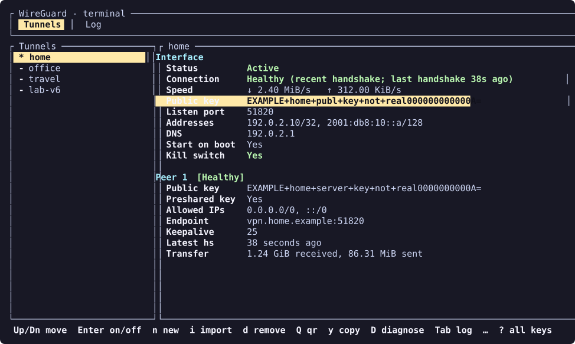
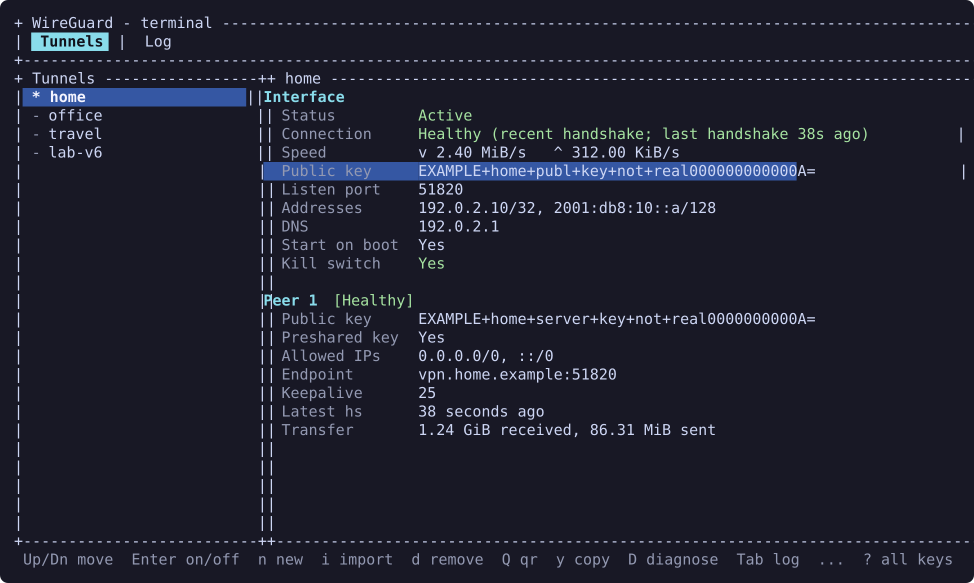

# ♿ Accessibility

`wg-tui` is a full-screen, keyboard-operated terminal application. This page
describes the current interaction options and limitations, honestly.
Screen reader, refreshable Braille display and voice-control compatibility are
unverified; there is no claim of accessibility conformance. If something
gets in your way, please [tell us](#-report-a-barrier) — that's how it gets
better.

## ⌨️ Keyboard controls

The interface never needs a mouse. Common controls:

| Action | Keys |
|---|---|
| Show the key map | `?` |
| Move through tunnel or file lists | Up/Down or `k`/`j` |
| Switch Tunnels and Log tabs | Tab or Shift+Tab |
| Connect/disconnect the selected tunnel | Enter or `a` on the Tunnels tab |
| Move between copyable detail fields and copy one | Left/Right or `h`/`l`, then `y` |
| Jump to the next / previous peer | `]` / `[` |
| Scroll the detail pane | Page Up/Down (it also follows the focused field) |
| Scroll the key map | Up/Down, `j`/`k`, Page Up/Down, `g`/`G` |
| Scroll the concepts guide or changelog | Up/Down, `j`/`k`, Page Up/Down, Home/End or `g`/`G` |
| Close the current view or quit | Esc or `q`, depending on the view; Ctrl+C exits |

Keys are context-sensitive: Enter copies on the Log tab, for example, and
popups consume keys. The key-map popup scrolls with the keys above and closes
on any other key. It is built from the same table that maps keys to actions,
and automated tests check that every action has a key, that every documented
key works in its tab, and the focus order of detail fields and peers. The
complete bindings are in the [README's key tables](README.md#%EF%B8%8F-keys)
and the [tutorial](docs/TUTORIAL.md).

Config editing uses an external editor selected by `VISUAL`, then `EDITOR`,
then `nano`, so you can pick one that works with your assistive tools. The TUI
suspends while the editor is open and restores its terminal state afterward.
Editor command arguments support quoting, without shell expansion.

## 🎨 Display and feedback

- Font size and zoom are controlled by the terminal emulator. Increasing the
  font size reduces the number of visible rows and columns.
- Three themes are available with `--theme NAME` or the `WG_TUI_THEME`
  environment variable: `default`, `high-contrast` (bright text, no dark grey,
  a yellow selection bar) and `ascii` (only ASCII characters: `+-|` borders,
  no arrows, ellipses or block characters; the QR code uses `##` or coloured
  spaces). A non-empty `NO_COLOR` turns colours off in any theme; selection and
  state then use bold, reverse video and underline. Tests check that the ASCII
  theme renders only ASCII and that `NO_COLOR` output carries no colours.
- Active/inactive tunnels have `*`/`-` markers and text status as well as
  colour. Connection health and kill-switch problems are written out in words
  (for example "Idle", "Connection failed", "MISSING"), not only coloured.
- The concepts guide, changelog, key map and detail pane wrap and scroll. Below
  24x6 the app shows only a "terminal too small" note; narrow terminals stack
  the tunnel list above the details; short terminals use a one-line header.
  Popups with choices keep their key line visible when the text above is
  clipped. Rendering is tested at many sizes, from 1x1 to 300 columns.
- Status refreshes automatically. Some footer messages disappear after a short
  time; failures and anything that needs a decision open a popup that stays
  until a key is pressed. There are no dedicated spoken announcements or
  screen-reader mode.
- On the Log tab, `f` toggles following new lines, and `v` starts a selection
  using a frozen log snapshot. Log text can be copied or saved to a file.
- QR display is visual. Config export provides a text-file alternative. Both
  QR codes and exported configs can contain private keys.

| High contrast | ASCII only |
|:---:|:---:|
|  |  |

The full-screen display uses raw terminal input and an alternate screen.
Assistive technology may not interpret its layout or updates as it would a
line-oriented command. Terminal, multiplexer and SSH behaviour can differ.

## 💬 Text commands and clipboard

`wg-tui --help`, `wg-tui --version` and `wg-tui doctor` print text without
opening the full-screen interface. `doctor` checks prerequisites; these
commands do not provide a complete command-line interface for managing
tunnels.

Copy uses native clipboard tools when available and falls back to OSC 52.
Across SSH, a native helper may address the remote display; OSC 52 needs
support from the local terminal and any multiplexer. A copy status does not
prove the local terminal accepted an OSC 52 request. See the clipboard notes
under the [README's keys section](README.md#%EF%B8%8F-keys).

## 📣 Report a barrier

Use the [bug report form](https://github.com/JamilleJung/wireguard-tui/issues/new?template=bug_report.yml)
and describe the action that was blocked, the expected behaviour, the
version, your terminal and its size, local/SSH setup, and assistive
technology if relevant. A proposed fix is not required. Include only
information you are comfortable sharing.

Remove keys and sensitive network details from examples, logs and
screenshots. Do not attach full configs, QR codes or backup archives. For
security issues, use the private reporting options in
[SECURITY.md](SECURITY.md).
