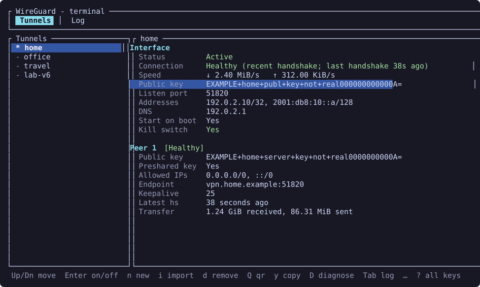
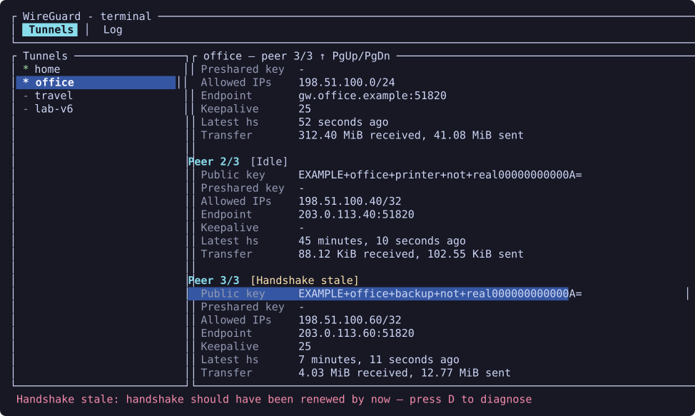
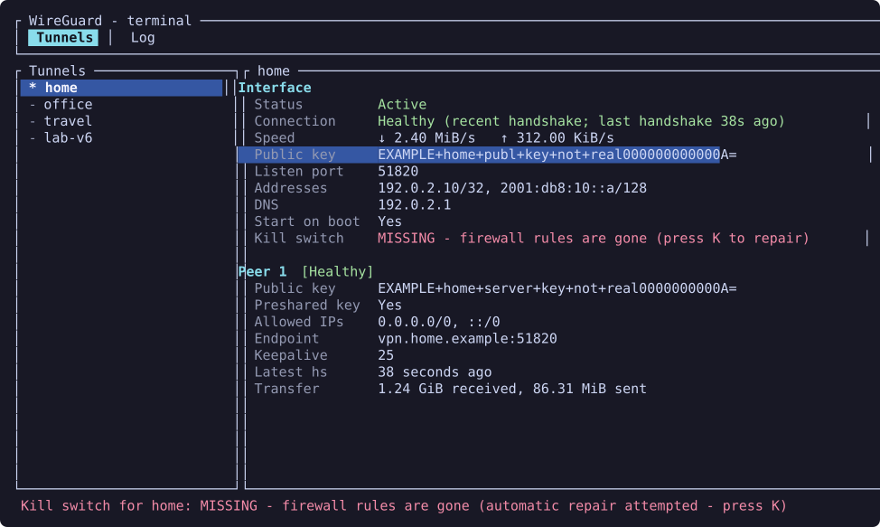
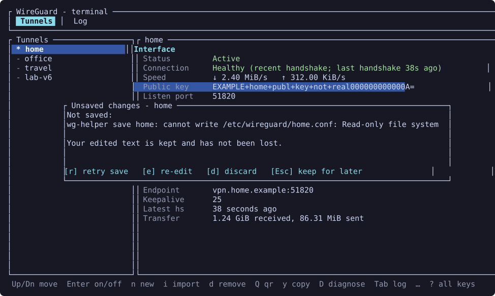
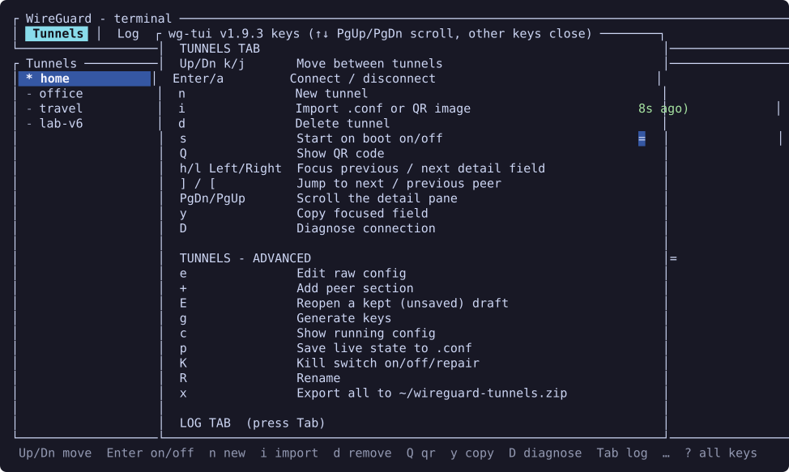
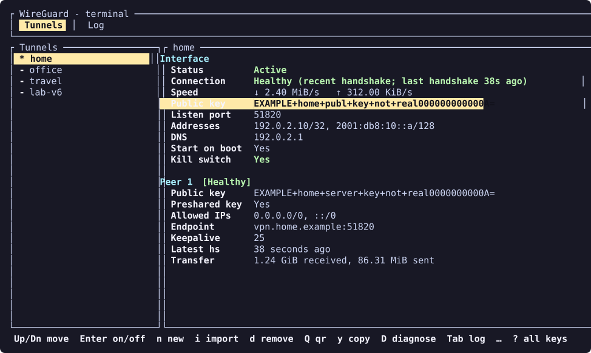
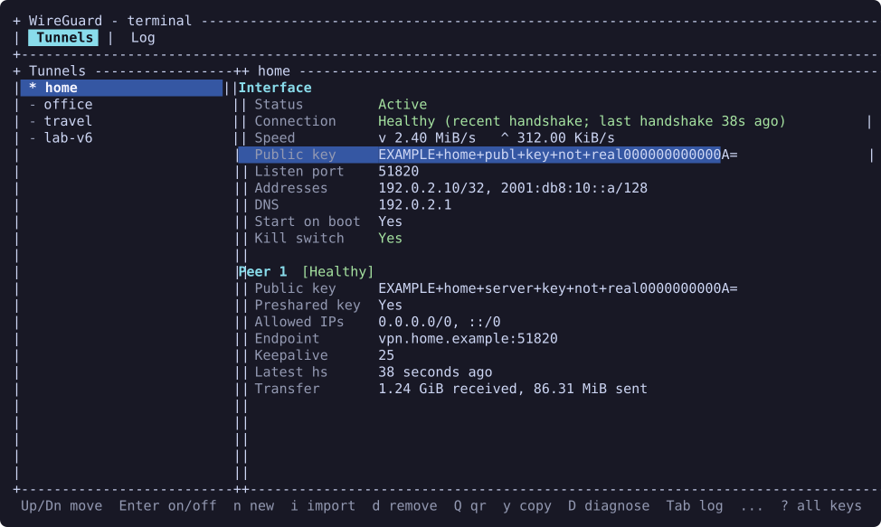
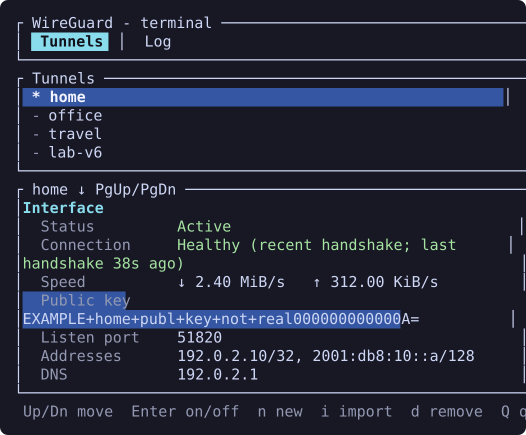
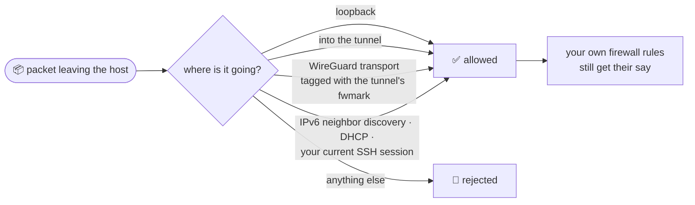
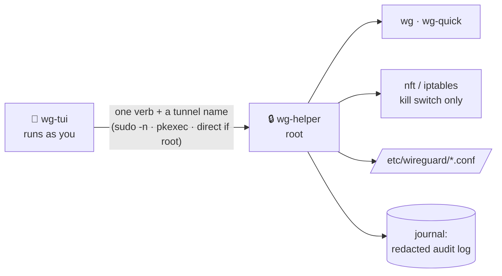

<div align="center">


# 🐉 wireguard-tui

### WireGuard tunnels, one keystroke away. No browser tab required.

A native Linux **terminal UI** for plain WireGuard — `/etc/wireguard/*.conf`,
`wg` and `wg-quick` — with every root operation kept behind one small,
auditable Rust helper. Works in a local terminal, over SSH, on a Raspberry Pi,
or on that VPS you forgot you were paying for.

[](https://github.com/JamilleJung/wireguard-tui/actions/workflows/ci.yml)
[](https://github.com/JamilleJung/wireguard-tui/releases/latest)
[](LICENSE)




<sub>Rendered from the app's own UI code with fictional tunnels. No real keys were harmed in the making of this screenshot.</sub>

**[🚀 Install](#-install-one-command)** ·
**[🖼️ Tour](#️-a-quick-tour)** ·
**[⌨️ Keys](#️-keys)** ·
**[🛡️ Kill switch](#️-the-kill-switch-explained-like-youre-busy)** ·
**[🔐 Security](#-security-model)** ·
**[📚 Docs](#-docs)**

</div>

---

> [!TIP]
> **TL;DR** — `git clone https://github.com/JamilleJung/wireguard-tui && cd wireguard-tui && ./install.sh && wg-tui`.
> That's it. Go connect something. 🔌

Prefer clicking things? 🖱️ The sibling
**[wireguard-gui](https://github.com/JamilleJung/wireguard-gui)** is the same
idea as a native desktop app.

## 🎉 What's new in 1.10

The "fewer surprises" release. Grab it from the
**[v1.10.0 release page](https://github.com/JamilleJung/wireguard-tui/releases/tag/v1.10.0)**.

| | What changed | Why you'll like it |
|---|---|---|
| 🛡️ | **Kill switch, rebuilt** — its own nftables table / iptables chain, IPv6 Neighbor Discovery allowed | Never fights firewalld or your rules, your deny rules always win, and IPv6 endpoints stay reachable |
| 🔁 | **Self-repairing kill switch** — `missing` / `mismatch` states plus automatic repair | A firewall reload no longer silently switches your protection off |
| ✏️ | **Live edits keep the fwmark** — `wg syncconf` can't reset it any more | Editing a connected tunnel no longer breaks routing or the kill switch |
| 🩺 | **Health per peer** — Healthy, Connecting, Idle, No traffic, Handshake stale, Connection failed | A quiet tunnel reads as *Idle*, not broken |
| 📝 | **Drafts never vanish** — Retry / Re-edit / Discard, and restore rolls back on failure | A failed save or half-finished restore can't eat your work |
| 🧪 | **QR images decoded in a sandbox child process** | A hostile image can't crash the app (found by fuzzing!) |
| 🌗 | **Themes** — high contrast, ASCII, `NO_COLOR`, tiny-terminal layouts, scrollable help | Comfortable on any screen and any terminal |
| 📦 | **Installer remembers** your method and auth mode, rolls back on failure, speaks SELinux, no more `pacman -Sy` | Updates keep your setup; a failed install leaves nothing half-done |

Upgrading from 1.9.x? A kill switch built by the old version shows up as
`mismatch` once and is rebuilt automatically. Everything else just works.
The full list lives in the [changelog](CHANGELOG.md#1100---2026-11-05).

## 💡 Why does this exist?

Because `wg`, `wg-quick`, `systemctl` and `journalctl` are wonderful tools that
were clearly never introduced to each other. `wg-tui` puts the whole everyday
loop — list, connect, inspect, edit, import, diagnose, log — on one screen.

| It is | It is not |
|---|---|
| 🦀 one static Rust binary + one tiny helper | 🧱 Electron, a WebView, or 400 MB of Chromium to flip one tunnel on |
| 📄 plain `/etc/wireguard/*.conf` files | 🗄️ a config database you can't `cat` |
| 🧰 `wg`, `wg-quick`, systemd `wg-quick@<name>` | 🕸️ a NetworkManager plugin |
| 🖥️ happy over SSH on a headless box | 👻 a daemon that lives in your process list forever |
| 🔍 small enough to read in an afternoon | 🎩 a VPN provider (bring your own config) |

## 🖼️ A quick tour

| 🩺 Health per peer | 🛡️ Kill switch self-repair |
|:---:|:---:|
|  |  |
| **Idle ≠ broken.** Each peer gets its own verdict. | A firewall reload ate the rules? It notices, and puts them back. |
| 📝 **Drafts never vanish** | ⌨️ **Scrollable key map** |
|  |  |
| Save failed? Your edit waits for you: Retry / Re-edit / Discard. | `?` lists every key, generated from the same table the app uses. |
| 🌗 **High contrast** | 🔤 **ASCII mode** (for serial consoles and brave souls) |
|  |  |

<details>
<summary>📱 …and it still works in a terminal the size of a sticky note</summary>



Below 24×6 it politely asks for more room instead of drawing spaghetti.

</details>

## ✨ What it does

**🔌 Everyday tunnels**
- List, connect, disconnect, rename and remove tunnels with one key.
- Live interface and peer details: endpoint, allowed IPs, handshake age, transfer, throughput.
- Per-peer health: 🟢 Healthy · 🔵 Connecting · ⚪ Idle · 🟡 No traffic · 🟠 Handshake stale · 🔴 Connection failed.
- systemd start-on-boot, running config (`wg showconf`), save live state (`wg-quick save`).

**📝 Configs, imports and backups**
- Edit raw config in `$VISUAL` / `$EDITOR` / `nano`; edits to a running tunnel are applied live with `wg syncconf`.
- Create from presets (Interface-only, full tunnel, split tunnel), generate keys, show a QR code.
- Import `.conf` files or PNG/JPEG QR images; export everything to ZIP; private backups shared with the desktop app.
- A draft that fails validation or saving is **kept** — Retry / Re-edit / Discard.

**🛡️ Safety nets**
- A temporary kill switch (nftables or iptables) that detects lost rules and repairs itself.
- Every action is checked against the real state afterwards; timeouts are re-checked, not guessed.
- Backup restore rolls back if anything fails halfway.
- Imports never hang on a FIFO, and QR images are decoded in a throwaway child process.

**🩹 Help when things are weird**
- `wg-tui doctor` (read-only checklist) and `wg-tui setup` (confirmed fixes).
- `D` diagnoses a tunnel: clock, handshake, endpoint ping, DNS.
- In-app guide, changelog, log viewer with filters, and verified in-app updates.

**♿ Comfortable for everyone**
- Default, high-contrast and ASCII themes; `NO_COLOR` respected.
- Everything reachable by keyboard (it's a TUI — we'd hope so), scrollable panes, small-terminal layouts.

<a id="install"></a>

## 🚀 Install (one command)

```sh
git clone https://github.com/JamilleJung/wireguard-tui.git
cd wireguard-tui
./install.sh        # run as your normal user, not root
wg-tui doctor       # optional: a quick health check
wg-tui              # 🎉
```

That's it. The installer:

1. 🔎 detects `apt-get`, `dnf`/`yum`, `pacman`, `zypper`, `apk`, `xbps-install` or `eopkg`;
2. 📦 installs only the runtime packages that are actually missing (plus a C toolchain and Rust via rustup if it has to build);
3. 🦀 builds as you, then installs to `/usr/local` with the helper in `/usr/local/lib/wireguard-tui/`;
4. 🔑 sets up helper authorization (a scoped sudoers grant by default);
5. 🧾 records what it did, so re-runs and updates keep your choices.

| Option | What it does |
|---|---|
| `--sudoers` | Default: passwordless helper grant for the invoking user |
| `--polkit` | A group-restricted polkit rule instead (`wireguard` group, active local session) |
| `--desktop` / `--no-desktop` | Install / skip the app-menu launcher and icon (installed by default) |
| `--binaries=DIR` | Install prebuilt binaries from `DIR` instead of building |
| `--force` | Install even though a distribution package copy exists |
| `--allow-root` | Allow installing from a direct root login |
| `uninstall` | Remove everything the installer added; your tunnel configs stay put |

> [!NOTE]
> Your tunnels in `/etc/wireguard` are never touched by install, update or uninstall.

<details>
<summary>🧾 What the installer promises (the fine print, all of it true)</summary>

- **It remembers.** A root-owned `PREFIX/lib/wireguard-tui/install-manifest`
  records the install method, prefix, authorization mode and desktop choice.
  A re-run, `--update` or the in-app updater keeps them unless a flag changes
  them.
- **It undoes itself.** A failed or interrupted install restores the previous
  binaries, authorization files and `wireguard` group setup.
- **It won't double up.** If a distribution package already provides the app,
  it refuses to add a second copy under `/usr/local` (use the package manager,
  or `--force`). The in-app updater refuses to replace a package or
  `cargo install` copy and names the right update command instead.
- **It is nice to Arch.** Only missing packages are installed with
  `pacman -S --needed`, with no database refresh (no partial upgrades); run
  `sudo pacman -Syu` first if that fails.
- **It speaks SELinux.** With SELinux enforcing it labels the helper `bin_t`,
  restores file contexts and checks that the helper actually runs.
- **It validates everything.** Unknown options fail. Switching sudoers/polkit
  installs and validates the new grant before removing the old one; a failed
  sudoers validation or group enrollment keeps the previous authorization.
  `--polkit` requires pkexec up front, checks an existing `wireguard` group and
  membership before calling group tools, and works on Alpine/BusyBox without
  Shadow's `groupadd`/`usermod`.
- **No sudo?** It can re-run through `su` with the root password while keeping
  the invoking user for the build and the grant. A direct root login is refused
  unless `--allow-root` (or `WG_ALLOW_ROOT=1`) is set; prefer a normal user or a
  verified prebuilt bundle.
- **`PREFIX` rules.** Before privileged writes, `PREFIX` must be an absolute
  ASCII path of letters, digits, `/`, `_`, `.` and `-`, without empty, `.` or
  `..` components or a trailing slash, and existing ancestors must be root-owned
  and not group/other writable (symlinks refused). A group-writable
  `/usr/local` therefore fails. `--polkit` supports only `/usr` or
  `/usr/local`, matching the bundled rule. Custom layouts need matching helper
  discovery; see [CONTRIBUTING.md](CONTRIBUTING.md).

</details>

### 📦 Signed prebuilt releases

Every release ships **static musl binaries for every common Linux CPU** —
no glibc version roulette:

| Artifact | For | `uname -m` |
|---|---|---|
| `wireguard-tui-1.10.0-x86_64-linux.tar.gz` | 64-bit Intel/AMD | `x86_64` |
| `wireguard-tui-1.10.0-i686-linux.tar.gz` | 32-bit Intel/AMD | `i686`, `i386` |
| `wireguard-tui-1.10.0-aarch64-linux.tar.gz` | 64-bit ARM (Raspberry Pi 3/4/5, …) | `aarch64` |
| `wireguard-tui-1.10.0-armv7-linux.tar.gz` | 32-bit ARMv7 | `armv7l` |
| `wireguard-tui_1.10.0-1_amd64.deb` | Debian / Ubuntu | `x86_64` |
| `SHA256SUMS`, `SHA256SUMS.minisig`, `minisign.pub` | checksums, signature, key | — |

Grab them from the **[latest release](https://github.com/JamilleJung/wireguard-tui/releases/latest)**
and verify **before** you extract:

```sh
minisign -Vm SHA256SUMS -P RWTyrstfFCLYkpMwbcyBRl+aGGcJikl35GY1esJDO6HTEJFIMvUC8f1Q
sha256sum -c SHA256SUMS --ignore-missing --strict   # you want an OK for your file
tar -xzf wireguard-tui-1.10.0-x86_64-linux.tar.gz
cd wireguard-tui-1.10.0-x86_64-linux && ./install.sh
```

> [!IMPORTANT]
> A checksum alone proves nothing about who made the file, and a key downloaded
> next to the artifact is not a trust anchor. Use the key above (it matches
> [`minisign.pub`](minisign.pub) in this repo). Missing or bad signature files
> mean **stop**.

The bundle installer skips Rust and the compiler; it still installs runtime
packages and authorization. For the `.deb`:
`sudo apt install ./wireguard-tui_1.10.0-1_amd64.deb` (it ships the launcher
and polkit rule, but does not create the `wireguard` group — see
[authorization](#-security-model)). Recipes for AUR, RPM, Alpine and Void live
in [`packaging/`](packaging/PACKAGING.md); being there does not mean a distro
already publishes them.

<a id="usage-and-keys"></a>

## ⌨️ Keys

```text
wg-tui                    start the UI
wg-tui doctor             read-only checklist (exit 0 ok · 1 warnings · 2 critical)
wg-tui setup              confirmed fixes for missing prerequisites
wg-tui --theme NAME       default · high-contrast · ascii   (or WG_TUI_THEME)
wg-tui --debug            redacted debug log to stderr      (or WG_TUI_LOG=/path/file)
wg-tui --version | --help
```

A non-empty `NO_COLOR` turns colours off. An unknown argument exits `2`.
`install.sh` also creates the `wireguard-tui` alias; distro packages may ship
only `wg-tui`.

| 🔌 Tunnels tab | |
|---|---|
| `↑`/`k`, `↓`/`j` | Select tunnel |
| `Enter` / `a` | Connect or disconnect |
| `n` | New tunnel from a preset, opens the editor |
| `i` | Import `.conf` / `.png` / `.jpg` / `.jpeg` |
| `e`, `+` | Edit raw config / append a peer |
| `E` | Reopen a kept draft (Retry / Re-edit / Discard) |
| `g`, `c`, `p` | Generate keys / running config / save live state |
| `d`, `R` | Delete (confirmed) / rename (stops an active tunnel) |
| `s`, `K` | Start-on-boot / kill switch |
| `Q`, `x` | Show QR / export all to `~/wireguard-tunnels.zip` |
| `h`/`←`, `l`/`→`, `y` | Focus a detail field, copy it |
| `]`, `[` · `PgUp`/`PgDn` | Next / previous peer · scroll the detail pane |
| `D`, `H`, `w` | Diagnose / concepts guide / changelog |

| 📜 Log tab | |
|---|---|
| `↑`/`k`, `↓`/`j`, `PgUp`/`PgDn` | Move / page |
| `Home`/`g`, `End`/`G`, `h`/`l` | Top / bottom / scroll sideways |
| `f`, `t`, `/` | Follow newest / this tunnel only / text filter |
| `y` / `Enter`, `v`, `Y` | Copy line or selection / visual select / copy filtered log |
| `c`, `r`, `w` | Clear view / reload / save to `~/wireguard-tui-log.txt` |

**Everywhere:** `Tab`/`Shift+Tab` switch tabs · `B` backups (`n` new, `Enter`/`r`
restore, `d` delete, `x` export) · `?` key map (`↑`/`↓`, `PgUp`/`PgDn`, `g`/`G`,
`Esc`) · `A` about · `u` install a detected update · `q`/`Esc` quit · `Ctrl+C`
bail out. In the import browser: `Space` marks, `Enter` imports, `→`/`l` enters a
directory, `←`/`h`/`Backspace` goes up.

> [!NOTE]
> Looking for Easy/Advanced mode? It retired in 1.8.0 — every key works all the
> time now, and `m` does nothing (it's enjoying its pension).

<details>
<summary>📋 Clipboard, background work and other small print</summary>

- **Copy** tries `wl-copy`, `xclip`, `xsel` (Wayland-aware order), then OSC 52,
  each native attempt with a 2-second deadline. Over SSH a working remote
  clipboard may win; OSC 52 needs support in your terminal and multiplexer, and
  "copied" means the escape was sent, not that the terminal accepted it.
- **Background work.** Helper-backed actions run on serialized workers while
  navigation, help and logs stay responsive; a conflicting action reports that
  the app is busy. The external editor and the update install take the
  foreground on purpose. Leaving the app doesn't roll back an operation that
  already started. Log filters affect the view and `Y`; `w` saves the full
  fetched snapshot.

</details>

## 🛡️ The kill switch, explained like you're busy

Turn it on with `K` on a connected tunnel. From then on, anything trying to
leave your machine **outside** the tunnel gets politely rejected:



| Status | Meaning | What the app does |
|---|---|---|
| 🟢 `enabled` | Complete rules, and their mark matches the running tunnel | Nothing. Enjoy your coffee. |
| ⚪ `disabled` | Off | Nothing. |
| 🟠 `missing` | It was on, but the rules vanished (hello, `firewall-cmd --reload`) | Repairs it automatically, once per loss, with backoff |
| 🟡 `mismatch` | Rules exist but are stale (mark changed, tunnel down, built by an older release) | Repairs it on an active tunnel; tells you otherwise |

<details>
<summary>🔬 The nerdy details (nftables, iptables, fwmarks, IPv6)</summary>

- **Its own table, nobody else's.** With nftables the switch lives in a
  dedicated `inet wg_helper_killswitch` table with its own OUTPUT base chain,
  replaced in one nft transaction. It never edits another table, so firewalld,
  a distro ruleset or your own rules stay untouched.
- **iptables fallback.** A dedicated `WGH-KILLSWITCH` chain reached by one jump
  at the top of `OUTPUT`. Needs `iptables` + `iptables-restore`, and
  `ip6tables` + `ip6tables-restore` whenever the kernel has IPv6. Both families
  are preflighted; commits are atomic per family.
- **Your deny rules always win.** nftables `accept` only ends the kill switch's
  own chain, and the iptables chain `RETURN`s allowed traffic instead of
  accepting it, so later rules still apply. The iptables jump must stay first in
  `OUTPUT`; if another rule gets in front of it, the switch counts as
  incomplete (`missing`) and is rebuilt.
- **Allowed:** loopback; packets routed into the tunnel; WireGuard's transport
  (the tunnel's runtime fwmark); IPv6 router/neighbor solicitation and neighbor
  advertisement (hop limit 255) and MLDv2 reports — without them an IPv6
  endpoint goes dark once its neighbor-cache entry expires; DHCP client traffic;
  established SSH return traffic when `SSH_CONNECTION` reaches the helper.
- **Live edits are safe.** `wg syncconf` would silently reset the fwmark
  wg-quick set at runtime. The helper carries the running fwmark and listen port
  into the synced config, refuses a config that changes `FwMark` on a running
  tunnel (reconnect instead), re-reads the mark and repairs the switch if
  needed.
- **One at a time.** Only one tunnel can own the kill switch. It needs an
  already-active interface and can assign an unused runtime fwmark without
  touching the saved config; it never starts a stopped tunnel for you.
- **Fail closed.** Down/delete/rename keep protection when the interface is
  still up or its state is unknown. If the interface disappears without a
  disconnect, the rules stay and keep blocking (`mismatch`) until you
  disconnect. Quitting the app doesn't clear the rules.
- **Not persistent.** Rules and the "it was requested" marker live in the
  kernel and under `/run`, so both are gone after a reboot. A switch built by
  1.9.3 or older reports `mismatch` and is rebuilt in the new layout.
- This is host-output control — not forwarding/NAT for a server, and not a
  general no-leak guarantee. It can interrupt remote access.

Proven against real kernels in CI: `tests/killswitch-e2e.sh` builds real
WireGuard tunnels in network namespaces (IPv4 and IPv6 endpoints × nftables and
iptables) and checks leaks, neighbor-cache expiry, deny-rule precedence, live
updates, firewall reloads and interface loss.

</details>

## 🩺 Is my tunnel actually OK?

WireGuard is a polite protocol: it only talks when it has something to say.
So an old handshake on a quiet tunnel isn't a funeral, it's a nap. 😴

| Health | Means |
|---|---|
| 🟢 **Healthy** | A handshake within the last 3 minutes |
| 🔵 **Connecting** | No handshake yet, but packets (or keepalives) are on their way |
| ⚪ **Idle** | Old handshake, nothing to send right now. Totally normal. |
| 🟡 **No traffic** | Never handshaked, and nothing has tried to go through yet |
| 🟠 **Handshake stale** | Old handshake while traffic (or a keepalive) should have renewed it |
| 🔴 **Connection failed** | Sending for 90+ seconds with no answer, or a keepalive peer that never answered |

The system clock only gets blamed as a *possible* cause, and only when
handshakes are actually failing and the clock isn't synced.

## ✏️ Editing, backups and imports

- Configs stay plain text: inline `#` comments and repeated Address / DNS /
  AllowedIPs are fine. The helper refuses `PreUp`/`PostUp`/`PreDown`/`PostDown`
  — they would run as root.
- Editing a running tunnel applies WireGuard settings live; Address / DNS /
  MTU / routing changes still need a reconnect. `p` (save live state) can
  replace saved settings — review the result.
- Backups live in `$XDG_DATA_HOME/wireguard/backups` (or
  `~/.local/share/wireguard/backups`), shared with the desktop app. **They
  contain unencrypted private keys.** So do QR codes, exports and running
  config.

<details>
<summary>📏 Limits, rollbacks and validation (for the curious and the auditors)</summary>

- **Imports** and editor output must be regular files ≤ 1 MiB. FIFOs and other
  special files are refused without waiting for a writer. QR images are decoded
  in a short-lived child process with a memory limit and a deadline, so a
  hostile image can only fail its own import.
- **Editor.** `$VISUAL`, then `$EDITOR`, then `nano`; shell-style quoting but
  no expansion or execution (use a wrapper script for pipelines). The draft is
  `0600` in an exclusive `0700` temp directory, cleaned up afterwards
  (including swap/backup files).
- **Backup directories** must belong to you and are tightened to `0700`;
  symlink directories are refused. ZIPs and exports are `0600`, uniquely named
  and published without overwriting another archive.
- **Export** reads every tunnel or reports an error — never a "successful"
  partial archive. Exports and saved logs are written privately, then
  published atomically; failed writes keep the old file, final symlinks are
  refused, and replacing a hardlink leaves its other names alone.
- **Restore** accepts only valid, unique, top-level `.conf` entries, rejecting
  bad names, invalid configs and hooks before the first save. Limits: 64 MiB per
  ZIP, 4,096 entries, 1,024 configs, 1 MiB per config, 16 MiB total. Backup
  files must be owned regular files with one link. Restore copies every config
  it will overwrite, then saves one by one; if a save fails or times out it
  **rolls back** and reports every tunnel it restored, removed, or — if a
  rollback step failed — left changed. It doesn't sync running interfaces.
  The helper's own per-save copies are under `/etc/wireguard/.backup/`.
- **Validation** is shared by the app and the helper: every directive, known
  sections and placement, canonical 32-byte base64 keys (padding bits too),
  CIDR/port/keepalive bounds and required peer fields. Supported: inline
  comments, repeated Interface sections and Address/DNS/AllowedIPs, scoped IPv6
  endpoints, named/numeric Table, FwMark hex/off, SaveConfig booleans. A
  present `PresharedKey` must be valid (omit it for no PSK). Unknown fields stay
  visible but can't be saved until fixed.

</details>

## 🩹 Doctor, setup and updates

- **`wg-tui doctor`** checks tools, the helper and its authorization,
  `/etc/wireguard`, resolvconf integration, systemd/journal and clock sync.
  Read-only; exits `0` (all good), `1` (warnings) or `2` (critical). It doesn't
  test the kernel module or prove connectivity.
- **`wg-tui setup`** offers confirmed installs of WireGuard tools and a
  resolver, or enables an inactive `resolvectl` shim. It never creates tunnels
  or enables start-on-boot. The helper creates `/etc/wireguard` on first save.
- **Updates.** At startup the app checks GitHub for a newer release (without
  blocking you); `u` installs it. The download is checked with HTTPS, the
  compiled-in minisign key and an exact checksum, then the verified installer
  runs with your recorded prefix and authorization mode. Restart afterwards.
  Package-manager installs are left to the package manager. Opt out with
  `WG_NO_UPDATE_CHECK=1` or `$XDG_CONFIG_HOME/wireguard-tui/no-update`.

<a id="authorization"></a>

## 🔐 Security model



- The helper accepts **only** a fixed set of verbs and validated tunnel names —
  no paths, no options, no shell. It runs tools from fixed system paths with an
  empty environment, bounded output and hard deadlines.
- A passwordless grant can read every tunnel's private key and change
  networking. Give it to trusted operators only. The default is a per-user
  sudoers grant; `--polkit` instead requires an active local session **and**
  membership in `wireguard` (check `id -nG` after logging back in; packages
  install the rule but don't add members). SSH sessions don't count as "active
  local" — use the sudoers grant there.

<details>
<summary>🧐 Audited helper and update behaviour</summary>

- **Which helper?** Release builds only use this project's own
  `/usr/local/lib/` or `/usr/lib/` helper, or an adjacent **trusted** one:
  root-owned, executable, not group/other writable, with trusted parent
  directories. A user-owned extracted helper is refused until you install the
  verified bundle. Release builds never fall back to the build tree or the other
  app's helper; debug overrides exist for development only.
- **No password-dialog storms.** Background read-only requests ask polkit
  non-interactively first, so missing authorization becomes an actionable error.
  Explicit actions may still ask for authentication.
- **Bounded IPC.** Input and output are drained concurrently, capped at 4 MiB
  per stream, with an overall 90-second deadline (10 seconds for local key
  generation). A privileged process the UI can't signal may finish after a UI
  timeout — the app then re-reads the real state instead of guessing.
- **Updates.** The private download directory is owned and cleaned up on every
  path. Before escalation the whole bundle is checked (regular single-link
  files, no symlink components, a fresh exclusive staging tree); HTTPS-only
  redirects; the verified version must be newer than the running one. The
  updater picks the build for your CPU (x86_64/i686/aarch64/armv7) and fails
  explicitly on anything else.

</details>

Full details, threat model and limits: **[SECURITY.md](SECURITY.md)** ·
architecture and data flow: **[docs/ARCHITECTURE.md](docs/ARCHITECTURE.md)**.

## 🐛 Troubleshooting

<details>
<summary><b>"It says Idle. Is my VPN dead?"</b></summary>

Nope, it's napping. WireGuard only handshakes when there's traffic. Send
something (open a page, `ping` a peer) and watch it turn 🟢. If it goes 🟠 or
🔴 instead, press `D` to diagnose.
</details>

<details>
<summary><b>"Active", but <code>0 B received</code> and no handshake — ever</b> 🕰️🛸</summary>

Before you blame the server, check whether your machine has become a time
traveller. WireGuard stamps every handshake with the current time. If your
clock once leapt into the future (hello, dual-boot Windows and dying CMOS
batteries), the server remembers that future timestamp and — thanks to its
replay protection — politely ignores every *correctly timed* handshake you send
afterwards. Your packets cheerfully leave the building; the server just refuses
to talk to someone who keeps trying to "replay" tomorrow.

Fix: sync the clock (`timedatectl set-ntp true`, or install chrony), and if it
already drifted, reset the peer on the server (on wg-easy:
`docker restart wg-easy`). `D` (Diagnose) and the health view point at the
clock — but only when handshakes are really failing *and* the clock isn't
synced, because an idle tunnel with an old handshake is just napping. This
check was lovingly forged during one very long evening of staring at
`0 B received` and slowly losing our minds.
</details>

<details>
<summary><b>Connected, but nothing loads</b></summary>

Press `D`. Then check the server knows your peer key, the endpoint and port,
routing (AllowedIPs), the server firewall, DNS and your clock. "Interface is up"
proves the interface is up — sadly not that the internet loves you back.
</details>

<details>
<summary><b>Activating fails with a DNS / resolvconf error</b></summary>

`DNS =` needs a working `resolvconf`. If yours is the `resolvectl` shim,
systemd-resolved must be running. `wg-tui setup` can fix both; details per
distro in [docs/DISTROS.md](docs/DISTROS.md).
</details>

<details>
<summary><b>It keeps asking for a password / "authorization required"</b></summary>

Re-run `./install.sh` (sudoers) or `./install.sh --polkit` and log out and back
in. `wg-tui doctor` tells you which part is missing. Over SSH, polkit's
"active local session" rule won't match — use the sudoers grant.
</details>

<details>
<summary><b>The kill switch says <code>missing</code></b></summary>

Something reloaded the firewall and took the rules with it. The app repairs it
automatically on an active tunnel; if it can't, it tells you why. Turning the
switch off and on again also works (the classic).
</details>

<details>
<summary><b>A tunnel managed by something else behaves strangely</b></summary>

Two tools driving one interface is a sitcom plot, not a network setup. Don't
manage the same interface through NetworkManager (or another client) and
`wg-tui` at the same time.
</details>

## 🔧 Hacking on it

This is MIT open source — fork it and hack on your own ideas.

```sh
cargo build --release --locked
cargo run --release --locked --bin wg-tui -- --help
bash scripts/dev-setup.sh      # checks your machine has everything the checks need
```

### 🗺️ Codebase map

| Path | What lives there |
|---|---|
| `src/main.rs`, `src/cli.rs` | Startup, flags, terminal setup |
| `src/state.rs`, `src/input.rs`, `src/keymap.rs` | App state, key handling, the one key table that also builds `?` |
| `src/actions.rs`, `src/ops.rs` | Background operations and the operation state machine (verified against the real state) |
| `src/ui/`, `src/theme.rs` | Rendering, layouts for small terminals, themes |
| `src/editor.rs` | External editor and draft recovery |
| `src/backend.rs`, `src/backend/` | Helper client, backups, QR, per-peer health, diagnostics |
| `src/import_parse.rs`, `src/qr_isolate.rs`, `src/safe_file.rs` | Import parsing, isolated QR decoding, the one safe file-open routine |
| `src/config.rs`, `src/secrets.rs` | Config parsing/validation and secret redaction (compiled into the helper too) |
| `src/validation.rs` | Tunnel-name rules and import-name sanitising (property-tested against the helper's own check) |
| `src/doctor.rs`, `src/update.rs` | `doctor`/`setup` checks and the verified updater |
| `src/bin/wg-helper/` | The privileged helper: verbs, filesystem, runtime, firewall (`nft.rs`, `iptables.rs`), logging |
| `install.sh`, `packaging/` | Installer, polkit rule, desktop entry, distro recipes |
| `tests/` | Shell suites (helper, installer, namespace firewall, kill switch e2e, release contract), property tests, fixtures |
| `fuzz/` | cargo-fuzz targets for config, redaction, names, backup ZIPs and QR selection |

### 🔒 Adding privileged behaviour

Add a helper verb only when it maps to a concrete WireGuard operation. Keep the
input shape fixed, validate tunnel names before touching the filesystem, use
fixed paths, never go through a shell, back up before destructive changes,
check the resulting state, and never log private keys.

[CONTRIBUTING.md](CONTRIBUTING.md) has the full check list (fmt, clippy, tests,
property tests, fuzzing, mutation testing, namespace and end-to-end tests) and
the helper override rules. The app and helper are separate binaries;
`wg`/`wg-quick`, kernel modules and your editor are not bundled.

## 🚧 Known limitations

- Start-on-boot is systemd-only; other init systems need their own service.
- The kill switch is temporary host-output policy, not a daemon or a
  persistent firewall manager, and only one tunnel can own it at a time.
- The polkit rule needs an active local session, so over SSH use the sudoers
  grant.
- The `.deb` is amd64 only; other CPUs use the static tarballs.
- Distro recipes (AUR, RPM, Alpine, Void) are ready to submit but not yet in
  the official repositories.

## 🗺️ Roadmap

- Get the AUR, Fedora, Alpine and Void packages into their official repositories.
- Your idea here — [open an issue](https://github.com/JamilleJung/wireguard-tui/issues).

## 📚 Docs

| | |
|---|---|
| 🧭 [Tutorial](docs/TUTORIAL.md) | From zero to a connected tunnel, step by step |
| 📖 [WireGuard concepts](docs/help.md) | Keys, peers, AllowedIPs, handshakes — the in-app guide |
| 🐧 [Distros and DNS](docs/DISTROS.md) | Per-distro notes, resolvers, SELinux, client vs server |
| 🏗️ [Architecture](docs/ARCHITECTURE.md) | Privilege boundary, modules, data flow, kill switch design |
| 🔐 [Security](SECURITY.md) | Threat model, helper verbs, limits |
| 📦 [Releases](docs/RELEASES.md) · [Packaging](packaging/PACKAGING.md) | Verification, pipeline, distro recipes |
| ✅ [Release checklist](docs/RELEASE_CHECKLIST.md) · [Repo settings](docs/REPO_SETTINGS.md) | For maintainers |
| ♿ [Accessibility](ACCESSIBILITY.md) · 🤝 [Contributing](CONTRIBUTING.md) | Themes, keyboard, how to help |
| 📋 [Changelog](CHANGELOG.md) | What changed, and when |

## ⭐ Star this project

If `wg-tui` saved you from typing `sudo wg-quick down wg0 && sudo wg-quick up wg0`
one more time, **[give it a star](https://github.com/JamilleJung/wireguard-tui)** ⭐ —
it really does help other people find it. Watch the repo for releases, or fork
it and make it yours.

## ☕ Buy me a coffee

Built in spare time, fuelled by caffeine. If it made your day a little easier,
a coffee is hugely appreciated 💛

<div align="center">

[](https://www.buymeacoffee.com/jamillejung)

</div>

## 📄 License

MIT. WireGuard is a registered trademark of Jason A. Donenfeld; this is an
independent, unofficial project, not affiliated with or endorsed by the
WireGuard project.
