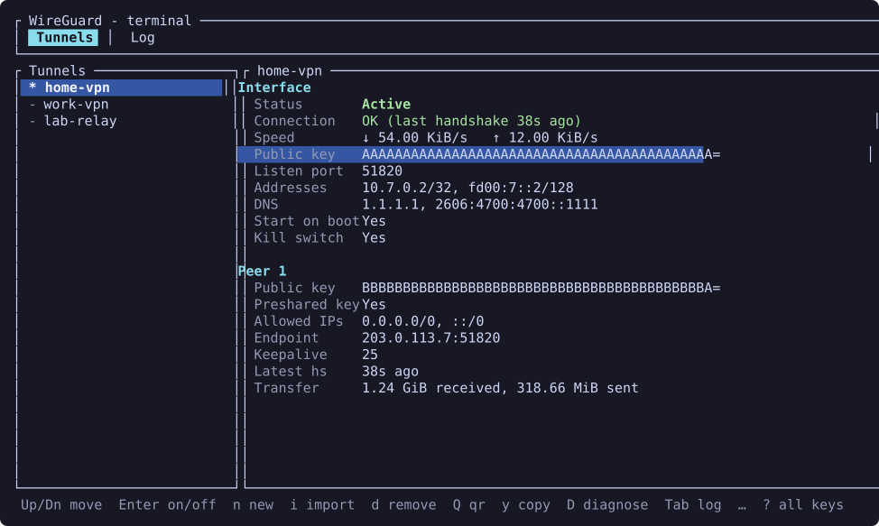

<div align="center">

# wireguard-tui - `wg-tui`

A native Linux terminal UI for plain WireGuard tunnels. Current release: **1.9.1**.

[](https://github.com/JamilleJung/wireguard-tui/actions/workflows/ci.yml)
[](https://github.com/JamilleJung/wireguard-tui/releases/latest)
[](LICENSE)



</div>

*Illustrative 1.9.1 UI example rendered from application code with fictional tunnel data.*

Built with Rust and ratatui, `wg-tui` manages `/etc/wireguard/*.conf` through
`wg`, `wg-quick`, and a small privileged Rust helper. It works in a local
terminal or over SSH without a graphical desktop, NetworkManager, or a daemon
of its own. The separate [wireguard-gui](https://github.com/JamilleJung/wireguard-gui)
project provides a desktop interface; the two frontends have different controls.

## What it does

- List, connect, disconnect, rename, and remove tunnels; show live peer details,
  handshake age, transfer totals, and throughput.
- Import `.conf` files or PNG/JPEG QR images, create a tunnel from a preset,
  edit raw config in an external editor, generate keys, and display QR codes.
- Apply WireGuard-level edits with `wg syncconf`, inspect running config, save
  live state, and toggle systemd start-on-boot.
- Copy focused detail fields and log lines, filter/save logs, and manage ZIP
  backups shared with the desktop client.
- Run connection diagnostics, read the in-app guide/changelog, and install
  verified release updates when a newer version is detected.
- Toggle a temporary helper-managed kill switch using nftables or
  iptables/ip6tables.

All keys are available immediately. Since 1.8.0 there is no Easy/Advanced mode
switch; **`m` has no action**. The "Advanced" group in `?` is just a key category.

## Install

### Source installer

Run as your normal user:

```sh
git clone https://github.com/JamilleJung/wireguard-tui.git
cd wireguard-tui
./install.sh
wg-tui doctor
wg-tui
```

The installer detects `apt-get`, `dnf`/`yum`, `pacman`, `zypper`, `apk`,
`xbps-install`, or `eopkg`. It installs runtime packages, a C build toolchain
when needed, and Rust through rustup if absent; then builds as the invoking
user. It installs under `/usr/local` by default, with `wg-helper` under
`/usr/local/lib/wireguard-tui/`, and creates the `wireguard-tui` command alias.

A terminal application-menu launcher and icon are installed **by default**.
Use `--no-desktop` for a server without a launcher. Installer options are:

| Option | Effect |
|---|---|
| `--sudoers` | Default: passwordless helper grant for the invoking user |
| `--polkit` | Install a group-restricted polkit rule instead |
| `--desktop` / `--no-desktop` | Install / skip the launcher and icon |
| `--allow-root` | Explicitly allow installation from a direct root login |
| `uninstall` | Remove installed app/helper/auth files; keep tunnel configs |

If usable sudo is unavailable, the installer can re-run through `su` using the
root password while retaining the invoking user for the build and helper grant.
A direct root login without a normal user is refused unless `--allow-root` (or
`WG_ALLOW_ROOT=1`) is set. That override can permit a source build as root;
prefer a normal user or a verified prebuilt bundle. `PREFIX` can change install
paths, but helper discovery and shipped polkit rules use the documented standard
paths. Custom layouts require matching authorization and an explicit supported
helper override; see CONTRIBUTING.md.

### Signed prebuilt releases

[Release 1.9.1](https://github.com/JamilleJung/wireguard-tui/releases/tag/v1.9.1)
provides:

| Artifact | Host |
|---|---|
| `wireguard-tui-1.9.1-x86_64-linux.tar.gz` | 64-bit Intel/AMD |
| `wireguard-tui-1.9.1-i686-linux.tar.gz` | 32-bit Intel/AMD |
| `wireguard-tui-1.9.1-aarch64-linux.tar.gz` | 64-bit ARM |
| `wireguard-tui-1.9.1-armv7-linux.tar.gz` | 32-bit ARMv7 |
| `wireguard-tui_1.9.1-1_amd64.deb` | Debian/Ubuntu amd64 |

The tarballs contain static musl application/helper binaries, `install.sh`,
installer assets under `packaging/`, README, and license. Choose the archive
matching `uname -m` (`armv7l` uses armv7). Verify it **before** extraction:

```sh
# Download the chosen artifact, SHA256SUMS, and SHA256SUMS.minisig first.
minisign -Vm SHA256SUMS -P RWTyrstfFCLYkpMwbcyBRl+aGGcJikl35GY1esJDO6HTEJFIMvUC8f1Q
sha256sum -c SHA256SUMS --ignore-missing --strict
# Require an OK line for the exact artifact you chose.
tar -xzf wireguard-tui-1.9.1-x86_64-linux.tar.gz
cd wireguard-tui-1.9.1-x86_64-linux
./install.sh
```

The bundle installer stages both adjacent binaries and skips Rust and compiler
setup. It still needs runtime packages and authorization. From a direct root
login, use `./install.sh --allow-root` after verification. The attached
`minisign.pub` should match the key committed in this repository; a signature
verified only against an untrusted key downloaded with the artifact is not a
trust check. Missing or invalid signing files are a reason to stop installation.

For a verified `.deb`, install with `sudo apt install ./wireguard-tui_1.9.1-1_amd64.deb`.
It includes a launcher and polkit rule but no script to create the `wireguard`
group or add users. See [authorization](#authorization) and the
[packaging guide](packaging/PACKAGING.md). Distro recipes are supplied for
AUR/RPM/Alpine/Void; their presence does not imply publication in a distro
repository.

## Usage and keys

The binary accepts `--version` / `-V`, `--help` / `-h`, `doctor`, and `setup`.
An unknown argument exits `2`. The `wireguard-tui` alias is created by
`install.sh`; distro packages may provide only `wg-tui`.

| Tunnels tab | Action |
|---|---|
| `Up`/`k`, `Down`/`j` | Select tunnel |
| `Enter` / `a` | Connect or disconnect |
| `n` | Name a tunnel, choose Interface/full/split preset, open editor |
| `i` | Import `.conf`, `.png`, `.jpg`, or `.jpeg` through file browser |
| `e`, `+` | Edit raw config / append a peer section in the editor |
| `g`, `c`, `p` | Generate keys / show running config / save live state |
| `d`, `R` | Confirm deletion / rename (stops an active tunnel) |
| `s`, `K` | Toggle systemd start-on-boot / temporary kill switch |
| `Q`, `x` | Show QR / export all configs to `~/wireguard-tunnels.zip` |
| `h`/`Left`, `l`/`Right`, `y` | Focus a detail field, then copy it |
| `D`, `H`, `w` | Diagnose / concepts guide / changelog |

| Log tab | Action |
|---|---|
| `Up`/`k`, `Down`/`j`, `PgUp`/`PgDn` | Move cursor / page |
| `Home`/`g`, `End`/`G`, `h`/`l` | Top / bottom / horizontal scroll |
| `f`, `t`, `/` | Follow newest / selected-tunnel filter / text filter |
| `y` / `Enter`, `v`, `Y` | Copy line or selection / visual select / copy filtered log |
| `c`, `r`, `w` | Clear view / reload / save full fetched log to `~/wireguard-tui-log.txt` |

`Tab`/`Shift+Tab` switches tabs. `B` opens backups from either tab; `n` creates,
`Enter`/`r` restores after confirmation, `d` confirms deletion, and `x` exports
the selected ZIP to your home directory. `?` shows the key map, `A` shows About,
`u` installs a detected update, and `q`/`Esc` quits (`Esc` first cancels an active
log selection). Popups consume keys; `Ctrl+C` exits the app.

The import browser uses `Space` to mark files, `Enter` on a file to import marked files,
`Right`/`l` to enter directories, `Left`/`h`/`Backspace` to go up, and `Esc` to
cancel. Hidden files are not listed.

Log filters affect the view and `Y` copy; `w` saves the full fetched snapshot.

Copy tries native clipboard tools first (`wl-copy`, `xclip`, `xsel`, with the
order adjusted for Wayland), then OSC 52. Over SSH, a working remote display
clipboard can take precedence; otherwise OSC 52 requires support in the local
terminal and multiplexer. The "copied" status for OSC 52 means the escape was
sent, not that the terminal accepted it.

## Editing, backups, and kill switch limits

The editor is `$VISUAL`, then `$EDITOR`, then `nano`; its command is split on
whitespace, not parsed as shell syntax. Use a wrapper script for complex editor
arguments. The app suspends the terminal UI and opens a `0600` temporary file,
then validates and removes it. Configs remain plain text: inline `#` comments
and repeated Address/DNS/AllowedIPs are supported. The helper rejects script
hooks (`PreUp`, `PostUp`, `PreDown`, `PostDown`) on save/rename.

Editing an active tunnel attempts `wg syncconf`. Address/DNS/MTU/routing changes
still need a reconnect even if WireGuard-level synchronization succeeds.
Quick-add peer saves the file without a live sync. Saving live state (`p`) can
replace saved WireGuard settings, so review the result.

Backups live in `$XDG_DATA_HOME/wireguard/backups`, or
`~/.local/share/wireguard/backups`, as `0600` ZIP files. Restore preflights the
complete archive before saving: valid top-level `.conf` names, config shape,
no script hooks, no duplicate names, at most **1 MiB per config**, **16 MiB total**,
and **1024 configs**. Other file types are skipped. Validated configs are then
saved sequentially; a helper failure can leave a partial restore. Restore does
not apply the new configs to running interfaces.

The kill switch requires an active tunnel; the helper sets a runtime fwmark
when absent. It prefers nftables and otherwise uses iptables/ip6tables,
rejecting egress outside loopback, the tunnel, its mark, and detected established
SSH return traffic. Rules use exact tunnel-name comments and are inserted ahead
of existing allow rules. They are temporary, affect host output rather than
configure server forwarding/NAT, and can interact with other firewall managers.
App deactivation/delete/rename attempts cleanup. Reboot, external tunnel changes,
or firewall reloads require checking the rules again. After upgrading from an
older version, disable/re-enable an existing kill switch to replace old rules.
Keep another access path available when changing a remote firewall.

## Doctor, setup, and updates

`wg-tui doctor` checks tools, helper/authorization, `/etc/wireguard`, resolvconf
integration, systemd/journal availability, and Linux clock synchronization. It
is read-only and exits `0` (no warnings), `1` (warnings), or `2` (critical missing
requirements). It does not test the kernel module or prove connectivity.

`wg-tui setup` offers confirmed package installation for WireGuard tools and a
resolver provider, or activation of an inactive `resolvectl` shim. It points to
the installer for the helper and returns the refreshed doctor status. It does
not create tunnels, create `/etc/wireguard`, or enable tunnel start-on-boot.
The helper creates `/etc/wireguard` on the first save. `D` diagnoses a selected
tunnel using clock/handshake checks, endpoint ping, and DNS lookup; blocked ICMP
can make the ping inconclusive.

At startup the app checks GitHub for a newer release without blocking the UI.
`u` installs only when that startup check found one; it does not force a new
check. The updater uses HTTPS, a compiled-in minisign public key, an exact
archive checksum, and a private temporary directory. It re-runs the verified
installer using prebuilt binaries, may prompt for privilege, and requires an
app restart. Prefer your package manager for a distro-managed installation:
the updater uses the source installer's `/usr/local` layout and default sudoers
mode. Disable the startup check with `WG_NO_UPDATE_CHECK=1` or a persistent
`$XDG_CONFIG_HOME/wireguard-tui/no-update` file (default `~/.config/...`).

## Authorization

A passwordless helper grant can read private tunnel keys and change networking.
Give it only to trusted operators. The source installer defaults to a per-user
sudoers grant; polkit instead requires an active local session **and** membership
in `wireguard`. `--polkit` attempts group creation and membership setup; verify
membership with `id -nG` after logging out and back in. Package recipes only
install the rule, so an administrator must arrange membership separately.
An SSH session does not satisfy the active-local rule; use the scoped sudoers
installation or an administrator-approved privilege path.

The app tries direct execution when already root, otherwise authorized
`sudo -n`, then `pkexec`. It can reuse a co-installed desktop helper. Helper
verbs, fixed paths, atomic writes, backup behavior, updater trust, and known
security limits are detailed in [SECURITY.md](SECURITY.md). QR codes, generated
keys, running config, and exported backups may reveal private keys.

## Development and further reading

```sh
cargo build --release --locked
cargo run --release --locked --bin wg-tui -- --help
```

See [CONTRIBUTING.md](CONTRIBUTING.md) for the full check list and helper override
rules. The application and helper are separate binaries; the project does not
bundle `wg`/`wg-quick`, kernel modules, or an editor.

- [Step-by-step tutorial](docs/TUTORIAL.md)
- [WireGuard concepts](docs/help.md)
- [Distro and DNS guide](docs/DISTROS.md)
- [Release verification/build process](docs/RELEASES.md)
- [Changelog](CHANGELOG.md)
- [Packaging](packaging/PACKAGING.md)

If the app is useful, [star the project](https://github.com/JamilleJung/wireguard-tui)
or [buy the maintainer a coffee](https://www.buymeacoffee.com/jamillejung).

MIT licensed. WireGuard is a registered trademark of Jason A. Donenfeld; this
is an independent, unofficial project.
