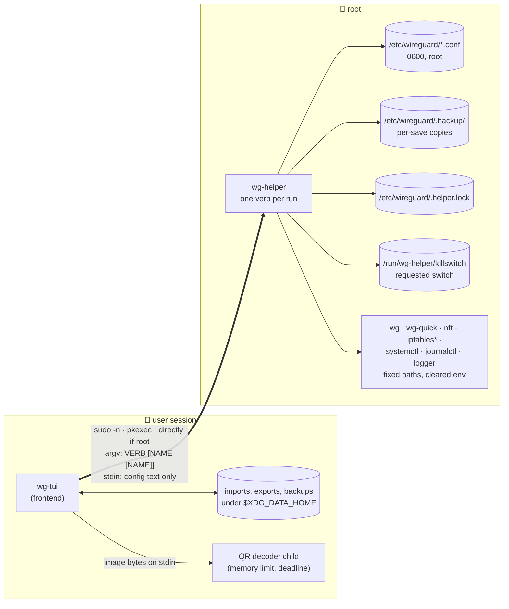
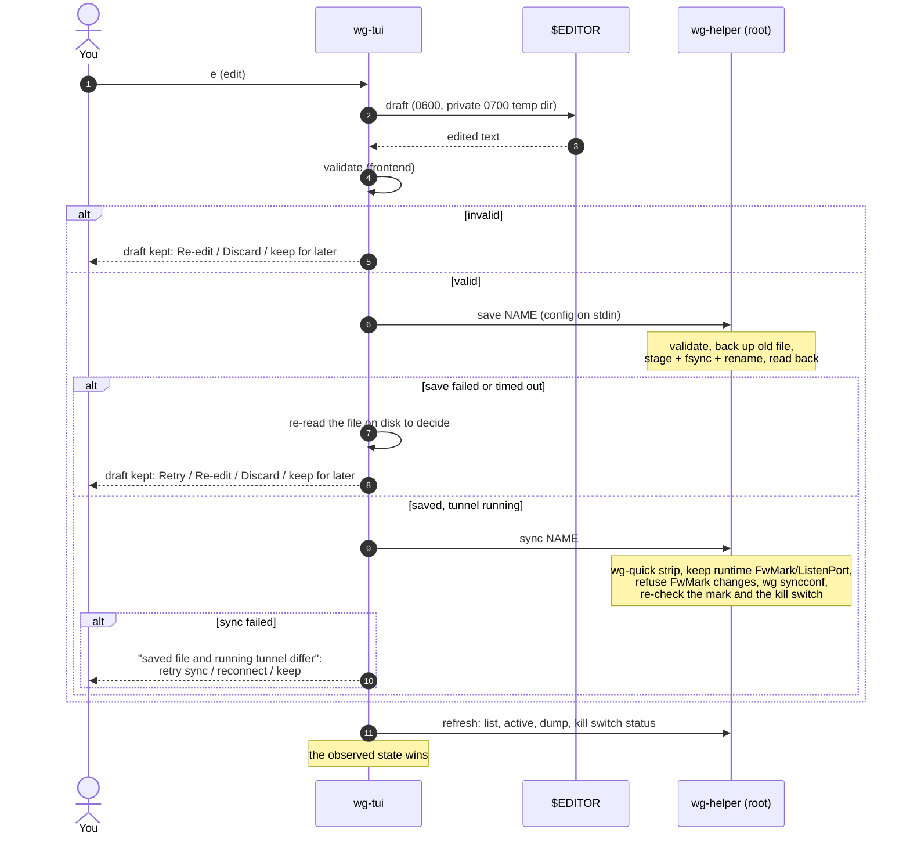
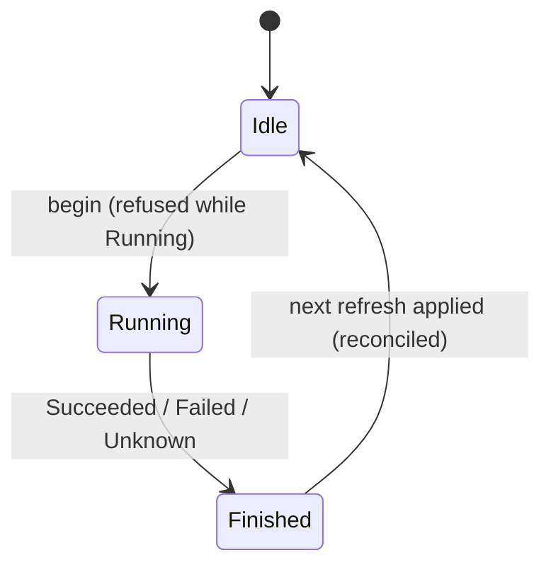
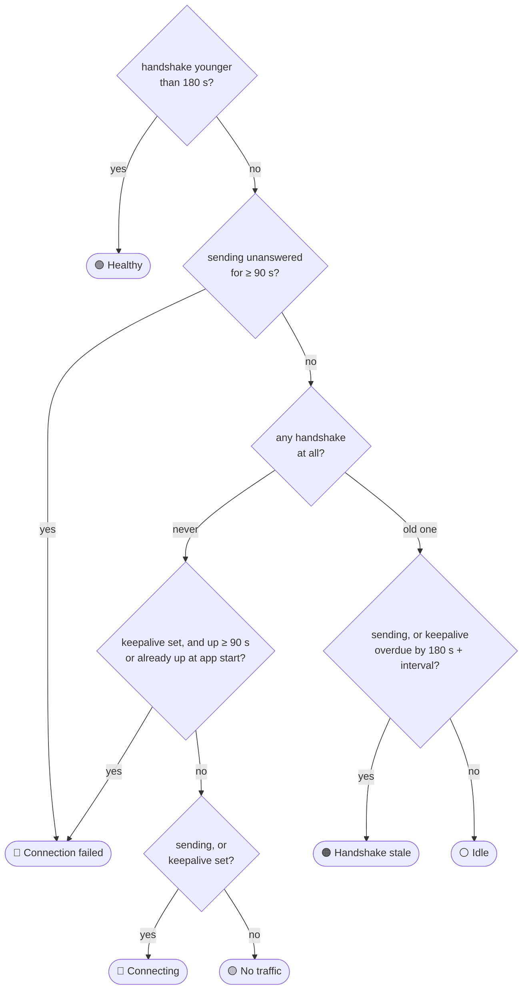
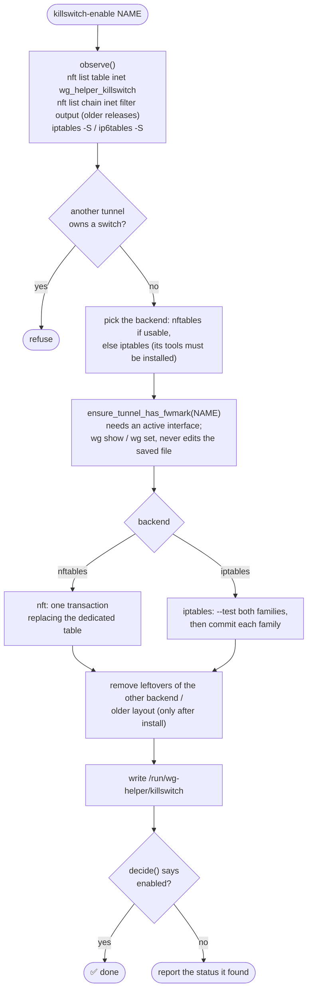
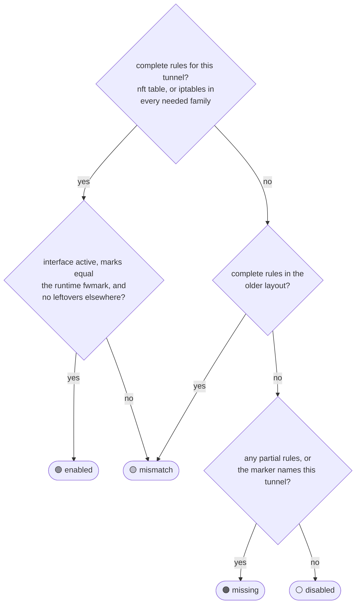

# 🏗️ Architecture

How `wireguard-tui` is put together, where the privilege boundary is, and how
data moves between the terminal UI, the privileged helper and the system.
Read it before changing anything under `src/bin/wg-helper/`, `src/backend/`
or the installer. (The diagrams are mermaid; GitHub renders them for you.)

## 🧩 Processes

| Binary | Runs as | Source |
| --- | --- | --- |
| `wg-tui` | the logged-in user | `src/main.rs` and the modules below |
| `wg-helper` | root (via sudo, pkexec, or directly when already root) | `src/bin/wg-helper/` |

`src/config.rs` and `src/secrets.rs` are compiled into both binaries, so the
frontend and the helper validate and redact configs with the same code.
Tunnel names are checked by `src/validation.rs` in the frontend and by
`name_ok()` in the helper; a property test (`tests/prop_names.rs`) checks that
the two agree on every random name. The helper is the authority: the frontend
validates to give early feedback, the helper validates again before anything
touches `/etc/wireguard`.

QR images are decoded by a third, short-lived process: `wg-tui` re-runs its
own executable as a decoder child (`src/qr_isolate.rs`) with a memory limit
and a deadline, so a crash or hang in the image or QR libraries only fails
that one import.

## 🗂️ Frontend modules

| Module | Responsibility |
| --- | --- |
| `main.rs` | entry point: module layout, CLI dispatch, terminal setup |
| `cli.rs` | command-line flags (`--theme`, `--debug`, subcommands), `doctor` / `setup` output |
| `runtime.rs` | event loop, background poller, startup update check, editor/update hand-offs |
| `state.rs` | `App` state: tunnels, selection, popups, drafts, health trackers; folds in background results |
| `input.rs`, `keymap.rs` | key handling; one key table that also builds the help text |
| `actions.rs` | user actions that start background operations and verify them afterwards |
| `ops.rs` | operation state machine (Idle → Running → Finished → reconciled); refuses overlapping mutations; kill-switch repair policy |
| `editor.rs` | external-editor drafts (private temp dir, draft recovery) |
| `ui/` | rendering: list, detail pane, popups, log view; layout breakpoints for small terminals |
| `theme.rs` | default, high-contrast and ASCII themes; `NO_COLOR` |
| `backend.rs`, `backend/` | everything that talks to the helper or reads user files: `helper.rs` (invocation, typed `HelperError`, pkcheck), `backup.rs` (ZIP export/restore with rollback), `qr.rs`, `health.rs` (per-peer health classification), `diagnostics.rs` |
| `import_parse.rs` | pure backup-ZIP and QR parsing with limits (shared with the fuzz targets and property tests) |
| `qr_isolate.rs` | the isolated QR decoder child process |
| `safe_file.rs` | the one routine for opening user-supplied files (no blocking on FIFOs/devices, regular files only, size limits) |
| `logging.rs` | opt-in structured debug log (`WG_TUI_LOG`, `--debug`), always redacted |
| `doctor.rs` | `wg-tui doctor` environment checks |
| `update.rs` | self-update that preserves the install method and authorization mode |

## 🔐 Privilege boundary

The frontend never runs a WireGuard or firewall tool as root itself. It runs
`wg-helper VERB [NAME [NAME]]`; the helper:

1. accepts only the fixed verbs in `verb_shape()` (`src/bin/wg-helper/main.rs`)
   and tunnel names matching `name_ok()` — no paths, options or shell text;
2. takes the shared mutation lock (`/etc/wireguard/.helper.lock`, bounded
   wait) for every mutating verb, so the TUI and GUI cannot interleave;
3. runs tools only from `/usr/sbin:/usr/bin:/sbin:/bin` with a cleared
   environment (only a fixed `PATH` and `LC_ALL=C`), bounded output, and a
   deadline enforced from the parent;
4. opens configs with `O_NOFOLLOW | O_NONBLOCK`, requires an owned regular
   file with one link and no group/other write bit, and caps input at 1 MiB;
5. validates configs and refuses `PreUp`/`PostUp`/`PreDown`/`PostDown`
   (they would run as root);
6. writes with stage → fsync → rename, keeping a backup of the old file;
7. checks the resulting state after every mutation (interface up/down,
   file present/absent, start-on-boot state, kill switch verified) and, after
   a timeout, reports the state it observed instead of guessing;
8. writes one structured, redacted `key=value` audit record per mutation to
   the journal (`journalctl -t wireguard-tui`).

Authorization is either a sudoers drop-in scoped to the helper path or a
polkit rule scoped to the helper path and the `wireguard` group (see
`packaging/49-wireguard-tui.rules`). Read-only polling never opens an
authentication dialog: with pkexec it first asks `pkcheck` without user
interaction.

## ✏️ Data flow of an edit

Every background operation goes through the same small state machine in
`ops.rs`. Only one runs at a time, and a finished one stays visible until the
next live refresh has been applied, so the UI shows the re-queried state
rather than the worker's own claim:

## 🩺 Health

`backend/health.rs` classifies each peer from successive `wg show dump`
snapshots: handshake age, rx/tx deltas, persistent keepalive and time since
activation. WireGuard only handshakes when there is traffic, so an old
handshake on a quiet tunnel is **Idle**, not a failure. **Handshake stale**
and **Connection failed** require traffic being sent without a fresh
handshake (or, for a keepalive peer, a handshake that is overdue or never
came). The system clock is mentioned only as a possible cause, and only when
handshakes are actually failing.

The interface summary is the most severe peer state.

## 🛠️ Helper modules

| Module | Responsibility |
| --- | --- |
| `main.rs` | verb table, name validation, lock, outcome logging |
| `process.rs` | fixed-path tool lookup, clean environment, bounded I/O, deadlines |
| `fsutil.rs` | private dirs, lock file, link-safe reads, backups, atomic writes |
| `runtime.rs` | `wg show`/`wg set`: interface state, fwmark, listen port, sync merge |
| `commands.rs` | tunnel verbs (`up`, `down`, `save`, `rename`, `delete`, `sync`, …) |
| `firewall/mod.rs` | kill switch policy, status decision, requested-state marker |
| `firewall/nft.rs` | nftables backend: dedicated `inet wg_helper_killswitch` table |
| `firewall/iptables.rs` | iptables backend: dedicated `WGH-KILLSWITCH` chain |
| `logging.rs` | structured, redacted journal records |

## 🛡️ Kill switch data flow

`killswitch-repair` runs the same install, but only for a tunnel whose switch
was requested (marker) or still has complete rules. `killswitch-disable`
clears the marker **first**, so a partial cleanup is never "repaired" back,
then removes the rules from both backends.

`decide()` (pure, unit-tested) turns what was observed into one status:

| Status | Meaning | Frontend reaction |
| --- | --- | --- |
| `enabled` | complete rules whose mark equals the runtime fwmark | none |
| `disabled` | no rules and no request | none |
| `missing` | requested (marker) but rules gone or incomplete | run `killswitch-repair` |
| `mismatch` | rules present but stale: mark differs, interface down, older layout or leftovers | run `killswitch-repair`; if the interface is down, report it |

The frontend repairs automatically only on an active tunnel, once per
detected loss, with a growing delay between repeated losses (`ops.rs`,
`KillSwitchWatch`); a failed repair is not retried automatically.

Why the rules look the way they do:

* **Dedicated table / chain.** nftables `accept` ends only the current base
  chain, so exceptions in a separate table never override another table's
  `drop`. In iptables an `ACCEPT` in a jumped chain is final for the table,
  so the kill switch chain `RETURN`s allowed traffic to `OUTPUT`, where the
  administrator's later rules still apply, and the jump must be the first
  `OUTPUT` rule.
* **Exceptions.** Loopback; packets routed into the tunnel interface
  (unmarked plaintext); WireGuard's transport (the runtime fwmark); IPv6
  router/neighbor solicitation and neighbor advertisement with hop limit 255
  and MLDv2 reports with hop limit 1 (without them an IPv6 endpoint becomes
  unreachable once its neighbor cache entry expires); DHCPv4/DHCPv6 client
  traffic (lease renewal); return traffic of the SSH session the switch was
  enabled from. IPv4 ARP is not IP and is not filtered by these hooks.
* **Live config updates.** `wg syncconf` resets interface fields that the
  file omits — including the fwmark wg-quick sets at runtime. `sync` merges the
  live fwmark and listen port into the stripped config, refuses a config that
  changes the fwmark of a running tunnel (reconnect instead), re-reads the mark
  afterwards and repairs the kill switch if needed.
* **Firewall reloads.** A reload (`nft flush ruleset`, firewalld, a distro
  ruleset) can remove the rules. The marker under `/run` keeps the request, so
  status turns `missing` and the frontend repairs it. The marker is on tmpfs,
  so, like the rules, a kill switch does not survive a reboot.

These behaviours are exercised against real kernels by
`tests/firewall-namespace.sh` (rule batches, atomicity, foreign rules kept)
and `tests/killswitch-e2e.sh` (a real tunnel in network namespaces, IPv4 and
IPv6 endpoints, nftables and iptables).
