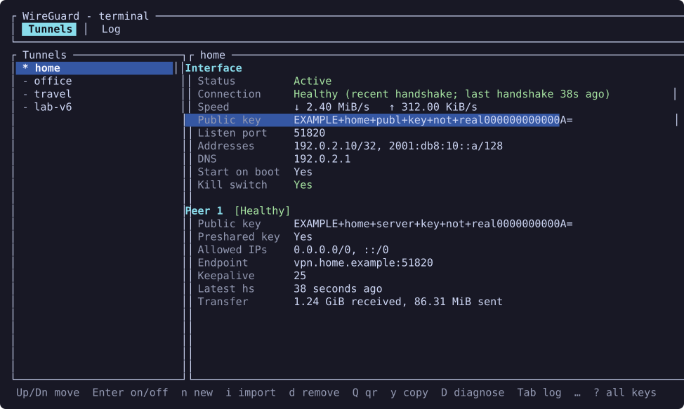
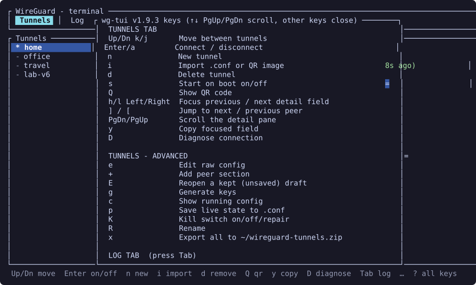
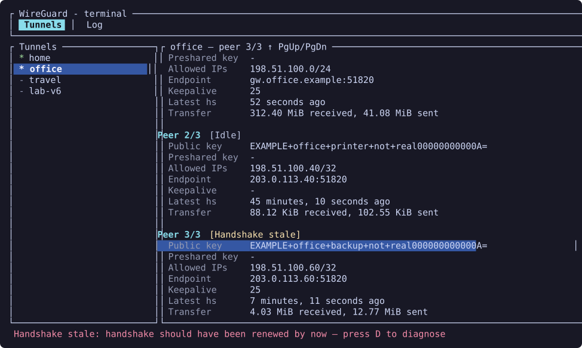
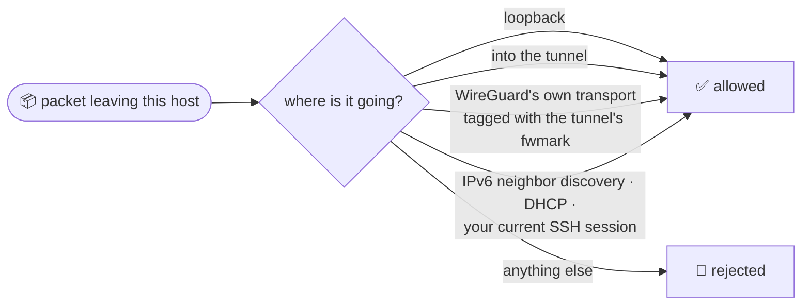
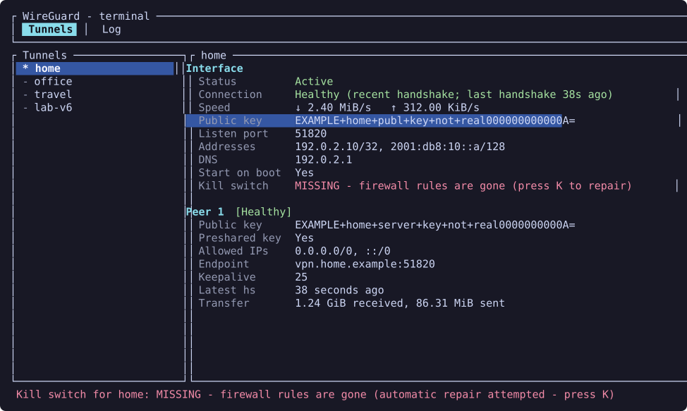
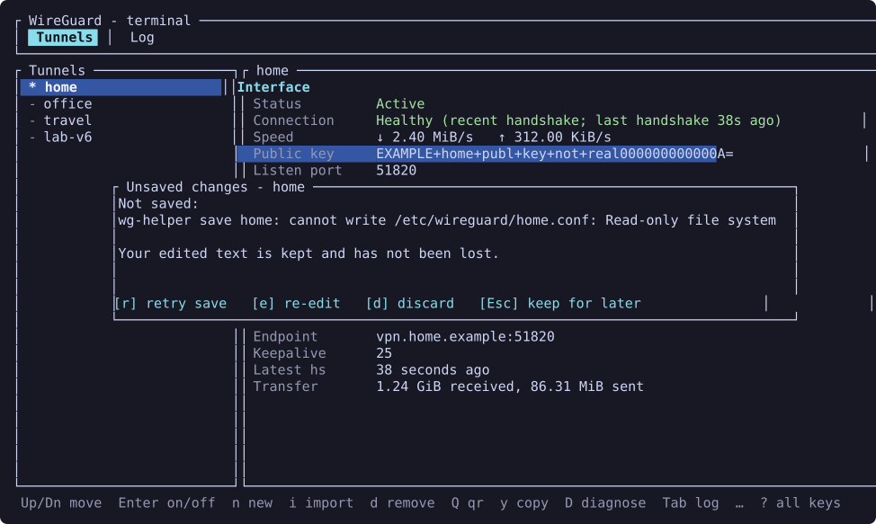
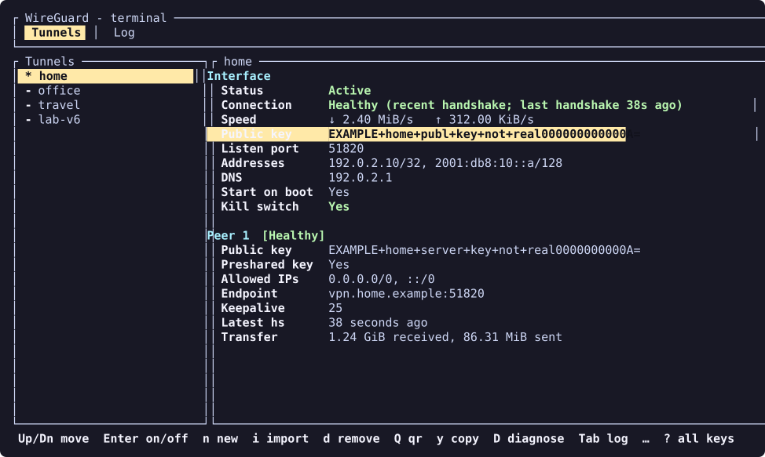
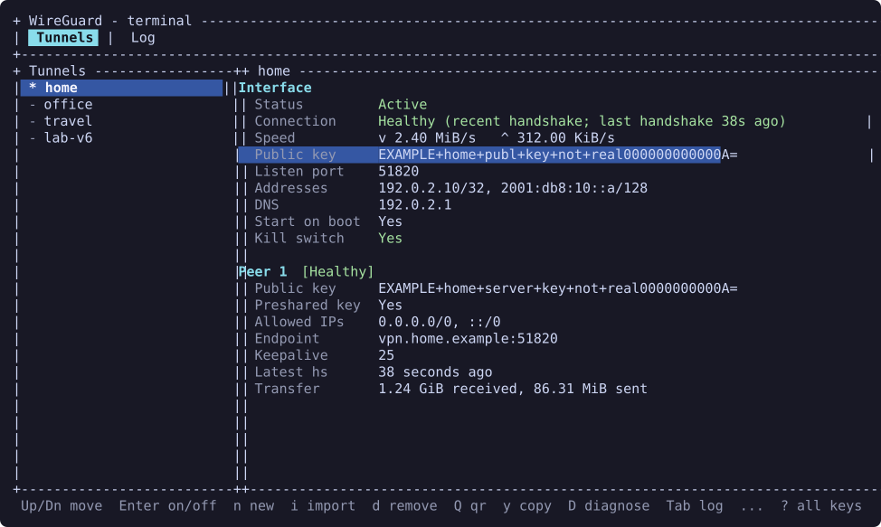
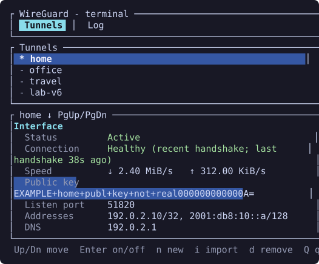

<div align="center">

# 🧭 The wireguard-tui tutorial

### From zero to a connected tunnel, one keystroke at a time.



No WireGuard experience needed. Every command is copy-pasteable,
and nothing here will make you edit a firewall by hand.

</div>

---

> [!NOTE]
> This tutorial describes **1.10.0** — per-peer health, draft recovery,
> themes and the self-repairing kill switch all arrived there (see the
> [changelog](../CHANGELOG.md)). Press `w` in the app to see what your own
> build has.

**Contents:**
[1. Who this is for](#1--who-this-is-for) ·
[2. Install](#2--install) ·
[3. First run](#3--first-run) ·
[4. Get a tunnel](#4--get-a-tunnel-three-ways) ·
[5. Connect](#5--connect-and-read-the-health) ·
[6. Kill switch](#6-%EF%B8%8F-the-kill-switch) ·
[7. Edit safely](#7-%EF%B8%8F-edit-safely) ·
[8. Everyday keys](#8--everyday-keys) ·
[9. Log tab](#9--the-log-tab) ·
[10. Backups](#10--backups-and-restore) ·
[11. Make it yours](#11--make-it-yours) ·
[12. Updates](#12--updates-and-removal) ·
[13. Troubleshooting](#13--troubleshooting)

## 1. 🎯 Who this is for

`wg-tui` (the source installer also adds the alias `wireguard-tui`) is a
keyboard-driven terminal app for plain Linux WireGuard: the `.conf` files in
`/etc/wireguard`, plus `wg` and `wg-quick`. It runs happily in a local
terminal or over SSH.

- 💻 **VPN clients** — you dial out to a provider or your own server and want
  to flip a tunnel on and off and see whether it actually works.
- 🖧 **Server / gateway admins** — you can manage the configs here too, but a
  server also needs forwarding, NAT and firewall work that this app does not
  do for you. [docs/DISTROS.md](DISTROS.md) explains the difference.

> [!TIP]
> Want the ideas behind keys, peers and AllowedIPs first? Press `H` in the app
> or read [WireGuard, explained](help.md). Ten minutes, no maths.

## 2. 📦 Install

Run the source installer as your **normal user** (not root):

```sh
git clone https://github.com/JamilleJung/wireguard-tui.git
cd wireguard-tui
./install.sh
wg-tui doctor
```

The installer finds your package manager, installs only the missing runtime
packages (and Rust plus a C toolchain when it has to build), builds as you,
then installs the app and its privileged helper. It also adds a terminal
launcher and icon to your app menu; `./install.sh --no-desktop` skips them.

### 🔑 How the app gets root (without nagging you)

Everything that needs root goes through one small helper. You pick how it is
authorized:

| Mode | Command | Good for |
|---|---|---|
| Sudoers (default) | `./install.sh` | Most setups, and **SSH** hosts |
| Polkit | `./install.sh --polkit` | Local desktops; needs an active local session **and** membership in the `wireguard` group |

With `--polkit` the installer tries to set up the group for you; log out and
back in, then check `id -nG`. SSH sessions don't count as "active local", so
over SSH you want the sudoers grant.

<details>
<summary>🧾 No sudo? Root login? Prebuilt bundles? (the fine print)</summary>

- **No usable sudo.** The installer can ask for the root password once through
  `su` while remembering your normal user for the build and the grant. Don't
  assume that starting a fresh `su -` login first keeps your original user.
- **Logged in as root directly.** That needs an explicit `--allow-root`
  (or `WG_ALLOW_ROOT=1`); a normal user is the better choice for source builds.
- **Prebuilt tarballs and the `.deb`.** Read the
  [release instructions](RELEASES.md) before downloading. A release tarball
  contains both binaries and skips the Rust/compiler setup; a plain source
  archive still has to build. The `.deb` installs the polkit rule but does not
  create the `wireguard` group or add anyone to it.
- **Unknown options fail** instead of being ignored, and switching between
  sudoers and polkit validates the new grant before removing the old one.

</details>

## 3. 🚀 First run

Two commands print a checklist and exit without opening the full-screen UI,
which makes them perfect for a quick look over SSH:

```sh
wg-tui doctor      # read-only checklist
wg-tui setup       # offers confirmed fixes for what's missing
wg-tui             # open the app 🎉
```

`doctor` checks the WireGuard tools, the helper and its authorization,
`/etc/wireguard`, DNS for tunnels (resolvconf), systemd, the journal and clock
sync. It answers with an exit code, so scripts can ask too:

| Exit code | Meaning |
|:---:|---|
| `0` | 🟢 All good |
| `1` | 🟡 Usable, with warnings |
| `2` | 🔴 Something critical is missing |

It doesn't prove a tunnel can connect, and it doesn't test the kernel module.

`setup` offers to install the WireGuard tools and a resolver (or enable an
inactive `resolvectl` shim), always asking first. It never connects tunnels,
enables start-on-boot, creates `/etc/wireguard` or installs the helper — the
helper creates `/etc/wireguard` on the first save, and the installer handles
the helper. Afterwards it prints a fresh doctor result.

Other handy flags: `wg-tui --version` (`-V`), `wg-tui --help` (`-h`),
`--theme NAME` and `--debug` (see [Make it yours](#11--make-it-yours)).

### ⌨️ Lost? Press `?`



`?` shows every key, built from the same table the app uses to handle them,
so it can't go out of date. It scrolls with `↑`/`↓`, `PgUp`/`PgDn` and
`g`/`G`; any other key closes it. Every key works all the time — the old
Easy/Advanced mode is gone, and "Advanced" in the key map is just a heading.

## 4. 📥 Get a tunnel, three ways

A tunnel is just a `.conf` file in `/etc/wireguard`. Pick whichever way fits.

### (a) 📄 Import a `.conf` from your provider or server

1. Press **`i`**. The browser starts in the current directory and shows
   folders plus `.conf`, `.png`, `.jpg` and `.jpeg` files (hidden files are
   skipped).
2. Move with **`↑`/`k`** and **`↓`/`j`**. **`→`/`l`/`Enter`** opens a folder,
   **`←`/`h`/`Backspace`** goes up.
3. Highlight the file and press **`Enter`**. Done!
4. Several at once? Mark each with **`Space`**, then press **`Enter`** on any
   file to import the whole marked set. **`Esc`** cancels.

### (b) 📷 Import from a QR-code image

Got a screenshot or photo of a WireGuard QR code? Open the same browser with
**`i`**, pick the `.png`/`.jpg`, press **`Enter`**. The image must contain
exactly one valid tunnel config; an ambiguous image is refused rather than
guessed at. (The decoding happens in a short-lived child process, so even a
nasty image can only fail its own import.)

### (c) ✨ Create one from a preset

1. Press **`n`** and type a name (up to 15 characters), then **`Enter`**.
2. Pick a preset: **`i`** Interface only, **`f`**/**`Enter`** full tunnel,
   or **`s`** split tunnel.
3. The app generates a private key and opens the config in `$VISUAL`, then
   `$EDITOR`, then `nano`. Fill in your address, the server's public key and
   endpoint, save, and exit the editor normally.

| Preset | What you get |
|---|---|
| Interface only | Just `[Interface]` with your new key and an address |
| Full tunnel | A peer with `AllowedIPs = 0.0.0.0/0, ::/0`, a DNS line and keepalive 25 |
| Split tunnel | A peer with `AllowedIPs = 10.0.0.0/24` and keepalive 25, no DNS line |

The placeholder values (`10.0.0.2/32`, `vpn.example.com:51820`, …) are there
to be replaced. The peer's `PublicKey` starts empty, so the app won't save
until you fill it in — and if you forget, your text is kept (see
[Edit safely](#7-%EF%B8%8F-edit-safely)).

<details>
<summary>📏 Import rules, names and limits</summary>

- Imported files and editor output must be **regular files of at most 1 MiB**.
  Named pipes, sockets, devices and directories are refused without waiting
  for a writer. QR images may be up to 32 MiB and 4096 × 4096 pixels.
- Names become Linux interface names: they start with a letter or digit, then
  use letters, digits, `_`, `-` or `.`, at most 15 characters, no `..` and no
  `.conf` suffix. Imported names are sanitized to fit and made unique.
- Validation runs in the app (early feedback) and again in the helper before
  anything is written. The helper refuses `PreUp`, `PostUp`, `PreDown` and
  `PostDown` — they would run as root. An administrator who really needs hooks
  must manage those files directly as root.
- Inline `#` comments and repeated `Address` / `DNS` / `AllowedIPs` lines are
  fine. Review an imported tunnel's details before you connect it.

</details>

## 5. 🔌 Connect, and read the health

Select a tunnel and press **`Enter`** (or **`a`**). Behind the scenes that's
`wg-quick up` / `down` through the helper. In the list, a green **`*`** means
up and a dim **`-`** means down.

"Up" means the interface exists — not yet that the other side is talking to
you. That's what the health line is for.



The detail pane merges the saved config with live `wg show` data about every
1.5 seconds: keys, addresses, DNS, endpoint, allowed IPs, keepalive, the
latest handshake, transfer counters and current throughput. Each peer gets its
own verdict:

| Health | What it means | Should I worry? |
|---|---|---|
| 🟢 **Healthy** | A handshake within the last 180 seconds | Nope 😎 |
| 🔵 **Connecting** | Handshake attempts in progress (just activated, or just started sending) | Give it a few seconds |
| ⚪ **Idle** | The last handshake is old because nothing needed sending | No — it's napping |
| 🟡 **No traffic** | Up, no handshake yet, and nothing has been sent that would start one | Send something to test it |
| 🟠 **Handshake stale** | Traffic or the keepalive should have renewed the handshake by now | Yes, press `D` |
| 🔴 **Connection failed** | Sending with no answer for longer than WireGuard retries (90 s), or a keepalive that never got a handshake | Yes, press `D` |

WireGuard only handshakes when it has something to say, so an old handshake on
a quiet tunnel isn't a funeral, it's a nap. 😴 The interface line shows the
most severe state among its peers; on a server with many peers, check each
one.

**Moving around the details:**

- **`h`/`l`** (or **`←`/`→`**) focuses a field, **`y`** copies it — handy when
  a server admin asks for your public key.
- **`]`** / **`[`** jumps to the next / previous peer.
- **`PgDn`/`PgUp`** scrolls the pane (it also follows the focused field).

**When something looks wrong, press `D`.** It checks the clock sync, whether
the tunnel is up, the handshake, an endpoint ping and a DNS lookup, then says
which step failed. These are clues, not proof: a failed ping doesn't mean the
WireGuard UDP port is down (many servers drop ICMP).

<details>
<summary>📋 How copying works (local, Wayland, X11, SSH)</summary>

Copy tries `wl-copy`, `xclip` and `xsel` (Wayland-aware order), each with a
2-second deadline, then falls back to the OSC 52 terminal escape. Over SSH a
working remote clipboard tool may win instead; OSC 52 needs support in your
local terminal and any multiplexer, and "copied" then means the escape was
sent, not that the terminal accepted it.

</details>

## 6. 🛡️ The kill switch

Press **`K`** on a **connected** tunnel. From then on, anything trying to leave
your machine outside the tunnel is rejected. Press `K` again to turn it off.



Your own firewall rules still get their say: the kill switch's "allowed"
never overrides somebody else's "deny".

| Status | Meaning | What happens |
|---|---|---|
| 🟢 `enabled` | Complete rules whose mark matches the running tunnel | Nothing. Enjoy your coffee ☕ |
| ⚪ `disabled` | Off | Nothing |
| 🟠 `missing` | It was turned on, but the rules are gone or incomplete (say, after `firewall-cmd --reload`) | The app repairs it on an active tunnel |
| 🟡 `mismatch` | Rules exist but are stale: the mark changed, the interface is down, or an older release built them (an iptables jump pushed out of first place counts as `missing`) | The app repairs it on an active tunnel |



The automatic repair runs once per detected loss; repeated losses are spaced
out by a growing delay, and a repair that fails is not retried on its own.
If you press **`K`** while the switch is on but not in force, a popup offers
**`r`** repair now, **`o`** turn it off, or **`Esc`** cancel.

> [!IMPORTANT]
> Only **one** tunnel can own the kill switch at a time — turn the existing one
> off before enabling another. It never starts a stopped tunnel for you.
>
> It is also **not persistent**. The rules and the "it was requested" marker
> live in the kernel and under `/run`, so:
>
> - Quitting the app keeps the switch on.
> - **Disconnect** turns it off. **Reconnect** does not turn it back on:
>   press `K` again.
> - A **reboot** clears it, even if the tunnel starts on boot.
> - If a **firewall reload** wipes the rules while the app is **closed**,
>   traffic can leave outside the tunnel until you open the app and it repairs
>   the switch.
>
> To block traffic from boot, or whenever no tunnel is up, use your own
> persistent firewall. The full table is in
> [SECURITY.md](../SECURITY.md#-kill-switch-scope-and-lifetime).

<details>
<summary>🔬 The nerdy details: nftables, iptables, fwmarks, IPv6</summary>

- **Its own table.** With nftables the switch lives in a dedicated
  `inet wg_helper_killswitch` table with its own OUTPUT base chain, replaced
  in one nft transaction. It never edits another table, so firewalld, a distro
  ruleset or your own rules stay untouched.
- **iptables fallback.** A dedicated `WGH-KILLSWITCH` chain reached by one
  jump at the top of `OUTPUT`. It needs `iptables` and `iptables-restore`, plus
  `ip6tables` and `ip6tables-restore` when the kernel has IPv6. Both families
  are preflighted; commits are atomic **per family**, not one transaction
  across IPv4 and IPv6.
- **Your deny rules win.** nftables `accept` only ends the kill switch's own
  chain, and the iptables chain `RETURN`s allowed traffic to `OUTPUT` instead
  of accepting it, so later rules still apply.
- **Allowed:** loopback; packets routed into the tunnel; WireGuard's transport
  (the tunnel's runtime fwmark); IPv6 router/neighbor solicitation and
  neighbor advertisement (hop limit 255) and MLDv2 reports; DHCP client
  traffic; established SSH return traffic when `SSH_CONNECTION` reaches the
  helper. Without the Neighbor Discovery exception an IPv6 endpoint goes dark
  once its neighbor cache entry expires.
- **The fwmark.** The helper can give an active tunnel an unused runtime
  fwmark without touching the saved config.
- **Live edits are safe.** `wg syncconf` would reset the fwmark wg-quick set
  at runtime. The helper carries the running fwmark and listen port into the
  synced config, refuses a config that changes `FwMark` on a running tunnel
  (reconnect to apply it), checks the mark afterwards and repairs the switch
  if needed.
- **Fail closed.** Disconnect, delete and rename keep the protection when the
  interface is still up or its state is unknown, and report what failed. If
  the interface disappears without a disconnect, the rules stay and keep
  blocking (status `mismatch`) until you disconnect.
- **Upgrades.** A switch built by 1.9.3 or older reports `mismatch` and is
  rebuilt in the new layout.
- **Scope.** This is host-output control, not forwarding/NAT for a server and
  not a general no-leak guarantee. It can interrupt remote access.

</details>

## 7. ✏️ Edit safely

| Key | Does |
|---|---|
| `e` | Edit the raw config in `$VISUAL`, then `$EDITOR`, then `nano` |
| `+` | Append a `[Peer]` template (commented-out lines) and open the editor; fill in at least `PublicKey` and `AllowedIPs` |
| `g` | Show a fresh keypair and preshared key (keep the screen private!) |
| `E` | Reopen a draft you set aside |

Save and exit the editor normally to submit your changes. If the editor exits
with an error status, the edit is cancelled. Editor arguments may be quoted
(`VISUAL="code --wait"` works), but nothing is expanded or run through a shell
— use a small wrapper script if you need shell tricks.

### 📝 Your edits never vanish

If your text doesn't validate, or the helper can't save it (permission, busy
lock, timeout, I/O error), the app **keeps your draft** and asks what next:



| Key | Does |
|---|---|
| `r` | Retry the save (offered for save failures only) |
| `e` / `Enter` | Re-edit, starting from your text |
| `d` | Discard (asks once more, just to be sure) |
| `Esc` | Keep the draft for later; `E` brings it back |

### ⚡ Editing a running tunnel

The file is saved first, then the WireGuard settings are applied live with
`wg syncconf`, so your connection isn't dropped. Changes to `Address`, `DNS`,
`MTU` or routing still need a reconnect, and a changed `FwMark` is refused by
the live sync and always needs one.

If the live sync fails after the save, the app tells you the saved file and
the running interface now differ and offers **`s`** retry sync, **`c`**
reconnect, or **`k`** (or `Esc`) keep as is.

<details>
<summary>🔍 What validation checks (and what it allows)</summary>

Validation is shared by the app and the helper. It checks every directive
occurrence, known sections and field placement, canonical 32-byte base64 keys
(padding bits included), CIDR/port/keepalive bounds and required peer fields.
Supported: inline comments, repeated `[Interface]` sections, repeated
`Address`/`DNS`/`AllowedIPs`, scoped IPv6 endpoints, named or numeric `Table`,
`FwMark` hex or `off`, and `SaveConfig` booleans. A present `PresharedKey` must
hold a valid key (omit the line for no PSK). Unknown fields stay visible in
the raw text but can't be saved until fixed.

The editor draft is a `0600` file in a fresh, exclusive `0700` directory. On
return, that directory is removed with everything in it, including editor
swap and backup files.

</details>

<details>
<summary>⏳ Background work, and why the app sometimes says "busy"</summary>

After connect, disconnect, rename, delete, start-on-boot and kill-switch
changes, the app re-reads the real state (interfaces, saved names, service and
firewall status) instead of trusting an exit code, and tells you if they
disagree. A helper timeout means "outcome unknown": the app re-checks and
shows what actually happened, or says it couldn't tell.

Helper-backed actions run on serialized background workers, so navigation,
help and logs stay responsive. A second action that would conflict is refused
with "Another operation is still running". The external editor and the update
installer take the foreground on purpose. Quitting doesn't undo an operation
that already started.

</details>

## 8. 🧰 Everyday keys

| Key | Action |
|---|---|
| `s` | Start on boot on/off (the systemd `wg-quick@<name>` unit; doesn't connect now) |
| `Q` | Show the saved config as a QR code for the WireGuard phone app |
| `c` | Show the running config (`wg showconf`) |
| `p` | Save the live state to the `.conf` (`wg-quick save`, after a backup) |
| `R` | Rename (stops an active tunnel and leaves it stopped) |
| `d` | Delete after a `y`/`Y` confirmation (backs the file up first) |
| `x` | Export every tunnel to `~/wireguard-tunnels.zip` |
| `r` | Refresh now |
| `H` · `w` · `A` | WireGuard explained · what's new · about |

> [!WARNING]
> QR codes, exports, backups, the running config and the `g` key popup all
> contain **private keys**. Anyone who photographs your screen during `Q` gets
> that tunnel. Show it when nobody's looking over your shoulder. 👀

If the QR doesn't fit, the app says so instead of drawing a cropped,
unscannable code — enlarge the window (or zoom out) and press `Q` again.

`p` writes whatever is running into the saved file, so it can replace
settings you only had on disk; review the result. Start-on-boot is
systemd-only; on OpenRC or runit, use your distro's own service manager
([docs/DISTROS.md](DISTROS.md)).

## 9. 📜 The Log tab

Press **`Tab`** (or `Shift+Tab`). The helper reads its own activity records
and the `wg-quick@*` journal entries; systems without journald show a short
note instead.

| Key | Action |
|---|---|
| `↑`/`k`, `↓`/`j`, `PgUp`/`PgDn` | Move the cursor, or page |
| `Home`/`g`, `End`/`G`, `h`/`l` | Top, bottom, scroll sideways |
| `f` | Follow the newest line |
| `t` | Only this tunnel |
| `/` | Text filter |
| `y` / `Enter` | Copy the current line or the selection |
| `v` | Start/end a visual selection (`Esc` cancels it) |
| `Y` | Copy the whole filtered log |
| `c` / `r` | Clear the view / reload |
| `w` | Save the full fetched log to `~/wireguard-tui-log.txt` (`0600`) |

A few friendly quirks: on this tab `g`, `c`, `w` and `Enter` mean the log
actions above, not their tunnel meanings. Filters change the view and `Y`, but
`w` always saves everything fetched. Clearing only clears the view, never the
journal. A visual selection freezes the log snapshot, so new lines can't shift
what you're copying, and `Esc` cancels a selection before it would quit.

## 10. 💾 Backups and restore

Press **`B`** from either tab:

| Key | Action |
|---|---|
| `n` | New backup ZIP of every tunnel |
| `Enter` / `r` | Restore the selected backup (asks first) |
| `d` | Delete the selected backup (asks first) |
| `x` | Copy the selected archive to your home directory |
| `Esc` | Close |

Actions run in the background and return you to the main view; press `B`
again to reopen the manager. Backups live in `$XDG_DATA_HOME/wireguard/backups`
(or `~/.local/share/wireguard/backups`) and are shared with the desktop app.

**Restore is all-or-nothing-ish, in a good way:** it checks the whole archive
first, copies every config it is about to overwrite, then saves one by one. If
a save fails or times out halfway, it **rolls back** — overwritten tunnels get
their old contents back and tunnels it created are removed again — and the
report names every tunnel restored, removed or (if a rollback step itself
failed) left changed. It overwrites matching names, leaves other tunnels
alone, and doesn't touch running interfaces.

> [!CAUTION]
> Backups contain **unencrypted private keys**. Treat a backup ZIP like the
> keys themselves.

<details>
<summary>📏 Backup limits and file rules</summary>

- Restore accepts only valid, unique, top-level `.conf` entries and rejects
  bad or duplicate names, invalid configs and hooks before its first save.
  Unrelated files in the archive are skipped.
- Limits: **64 MiB per ZIP**, **4,096 entries**, **1,024 configs**, **1 MiB
  per config**, **16 MiB of config text in total**.
- A backup file must be a regular file you own with a single hard link;
  symlinks and FIFOs are refused. Copy a hardlinked archive to an ordinary file
  first.
- Backup directories must belong to you and are tightened to `0700`; symlinked
  directories are refused. ZIPs and exported copies are `0600`, uniquely named
  even within the same second, and never overwrite another archive.
- Export reads every tunnel or reports an error, never a "successful" partial
  archive. Exports and saved logs are written privately, then published
  atomically: a failed write keeps the old file, a final symlink is refused,
  and replacing a hardlink leaves its other names alone.
- The helper also keeps its own per-save copies under
  `/etc/wireguard/.backup/` — a second safety net.

</details>

## 11. 🎨 Make it yours

| | |
|:---:|:---:|
|  |  |
| `wg-tui --theme high-contrast` | `wg-tui --theme ascii` |

- **Themes:** `default`, `high-contrast` (bright text, no dark grey, a yellow
  selection bar) and `ascii` (only ASCII: `+-|` borders, no arrows or
  ellipses; the QR code uses `##` or coloured spaces). Use `--theme NAME` or
  `WG_TUI_THEME=NAME`.
- **No colours:** a non-empty `NO_COLOR` turns colours off in any theme;
  selection and state then use bold, reverse video and underline.
- **Small terminals:** narrow terminals stack the list above the details.
  Below 24×6 the app politely asks for more room instead of drawing spaghetti.

<details>
<summary>📱 What it looks like at 60 columns</summary>



</details>

**Debug log:** `WG_TUI_LOG=/path/file` appends redacted `key=value` lines to a
private file, and `--debug` writes them to stderr (redirect it, for example
`wg-tui --debug 2>wg-tui.log`). Keys are removed before anything is written.

More on keyboard use and display options: [ACCESSIBILITY.md](../ACCESSIBILITY.md).

## 12. 🔄 Updates and removal

At startup the app quietly asks GitHub whether a newer release exists
(network failures stay silent). When one does, press **`u`**: the app steps
aside, verifies and installs it, then asks you to restart. With no update
detected, `u` just says so — it doesn't force a fresh check.

What "verifies" means: HTTPS only, the release's signed checksum list checked
against the **minisign key compiled into the app**, and an exact checksum for
the download. Verification needs `curl`, `tar`, `sha256sum` and `minisign`
(the app makes one best-effort attempt to install a missing `minisign`); an
update it can't verify is refused. The installer may ask for privilege.

- **Keeps your choices.** Updates reuse what the installer recorded: prefix,
  sudoers/polkit mode and launcher choice.
- **Package installs are left alone.** If a distro package (dpkg, rpm,
  pacman, apk or xbps) or `cargo install` owns the app, the updater refuses and
  names the right update command instead.
- **Opt out** with `WG_NO_UPDATE_CHECK=1` or a `no-update` file in
  `$XDG_CONFIG_HOME/wireguard-tui/` (default `~/.config/wireguard-tui/`).

To remove a source or prebuilt install, run its installer with the same
`PREFIX` you used originally:

```sh
./install.sh uninstall
```

For a distro package, use the package manager. Either way your tunnels in
`/etc/wireguard` and your backups stay where they are.

<details>
<summary>🧐 Updater and helper details (for the curious)</summary>

- The private download directory belongs to the updater and is cleaned up on
  every path. Before escalation the whole bundle is checked: regular
  single-link files, no symlink components, a fresh exclusive staging tree.
  Redirects must stay on HTTPS, and a release that is no longer newer than the
  running app is refused. Success reports the version actually verified.
- The updater picks the build for your CPU (x86_64, i686, aarch64, armv7) and
  fails clearly on anything else.
- Release builds only use this project's own `/usr/local/lib/` or `/usr/lib/`
  helper, or an adjacent **trusted** one (root-owned, executable, not
  group/other writable, with trusted parent directories). A user-owned
  extracted helper isn't trusted — install the verified bundle first.
- Background reads ask polkit non-interactively first, so missing
  authorization becomes a clear error instead of a storm of password dialogs.
  Helper calls have an overall 90-second deadline (10 seconds for local key
  generation) and at most 4 MiB of output per stream. A privileged process
  the app can't signal may still finish after a timeout, so check the real
  state before retrying.

</details>

## 13. 🐛 Troubleshooting

<details>
<summary><b>"It says Idle. Is my VPN dead?"</b></summary>

Nope, it's napping. WireGuard only handshakes when there's traffic. Send
something (open a page, `ping` an address behind the tunnel) and watch it turn
🟢. If it goes 🟠 or 🔴 instead, press `D`.
</details>

<details>
<summary><b>Active, but <code>0 B received</code> and no handshake — ever</b> 🕰️</summary>

Press `D` first. Check that the server knows your public key, the endpoint
and port are right, a preshared key (if any) matches on both ends, and UDP
isn't blocked on the way.

While you're there, ask one more question: **has your machine become a time
traveller?** It's a possible cause, not the usual suspect, but a sneaky one.
WireGuard stamps every handshake with the current time. If your clock once
leapt into the future (dual-boot setups and tired CMOS batteries have been
known to do this), the server remembers that future timestamp, and its replay
protection then politely ignores your *correctly timed* handshakes. Your
packets leave the building; the server just won't talk to someone who keeps
"replaying" tomorrow.

The fix: sync the clock (`timedatectl set-ntp true`, or install chrony). If
the clock already drifted, the server may need its peer state reset (on
wg-easy, `docker restart wg-easy`). `D` and the health line mention the clock
only when handshakes are really failing **and** the clock isn't synced —
because an idle tunnel with an old handshake is just napping.
</details>

<details>
<summary><b>Connected, but nothing loads</b></summary>

Press `D`, then check AllowedIPs (routing), the server firewall and DNS. "The
interface is up" proves the interface is up — sadly not that the internet
loves you back.
</details>

<details>
<summary><b>Activating fails with a DNS / resolvconf error</b></summary>

A `DNS =` line makes `wg-quick` call `resolvconf`. On minimal systems there
may be none, or a `resolvectl` shim whose systemd-resolved isn't running.
`wg-tui doctor` shows a "DNS for tunnels (resolvconf)" line, and
`wg-tui setup` can install a provider or enable the shim. Per-distro details:
[docs/DISTROS.md](DISTROS.md).
</details>

<details>
<summary><b>"can't gain root" / it keeps asking for a password</b></summary>

The app found neither a working passwordless `sudo` for the helper nor a way
through polkit. Re-run `./install.sh` (sudoers) or `./install.sh --polkit`,
then log out and back in. `wg-tui doctor` tells you which part is missing.
Over SSH, polkit's "active local session" rule won't match — use the sudoers
grant. Running the app as root also works: it then talks to the helper
directly.
</details>

<details>
<summary><b>The kill switch says <code>MISSING</code></b></summary>

Something reloaded the firewall and took the rules with it. On an active
tunnel the app repairs it automatically; if that fails, press `K` and choose
`r` to repair or `o` to turn it off. Off and on again works too (the classic).
</details>

<details>
<summary><b>Two tools are fighting over one tunnel</b></summary>

Don't manage the same interface through NetworkManager (or another client) and
`wg-tui` at the same time. Two drivers, one steering wheel — pick one.
</details>

---

<div align="center">

**Next stops:**
📖 [WireGuard, explained](help.md) ·
🐧 [Distros and DNS](DISTROS.md) ·
🔐 [Security](../SECURITY.md) ·
🏗️ [Architecture](ARCHITECTURE.md) ·
🤝 [Contributing](../CONTRIBUTING.md)

</div>
